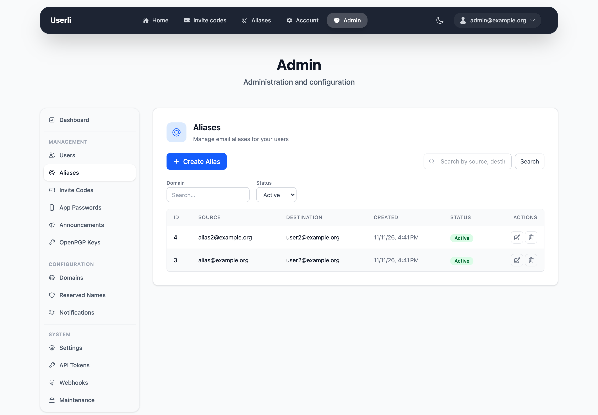

# Aliases

**Management → Aliases** lists the aliases of all users. Domain admins only see
the aliases of their own domain.

{class="screenshot"}

An alias forwards emails from a **source** address to a **destination**
address. Users create aliases themselves (see
[Aliases](../user/aliases.md) in the User Guide):

* up to 3 **custom** aliases, which they can't delete themselves,
* up to 100 **random** aliases, which they can delete at any time.

Filter the list by domain and status (active or deleted).

## Create and edit aliases

Admins can create aliases with any source on a managed domain and

* assign them to a **user** – emails go to that user, or
* set a free **destination** address – for example to forward to an external
  mailbox or a mailing list,
* set **SMTP quota limits** for the alias.

Domain admins can create aliases in their own domain and assign them to a user.
They can't set a free destination or quotas.

!!! warning

    When a domain admin saves an alias with a free destination, the destination
    is replaced by the assigned user. Ask an admin to edit such aliases.

## Delete aliases

Delete aliases with the *delete* action, for example when a user asks to remove
a custom alias. A deleted address is blocked and can't be registered or used as
an alias again.

The CLI command `bin/console app:alias:delete` does the same, see
[Console commands](../operations/commands.md).

## Convert an alias to a user

Use the *convert to user* action when an address should get its own mailbox,
for example when a shared alias becomes a personal account. Set an initial
password for the new user. Userli then

* deletes the alias – new emails go to the new mailbox, emails that were
  already forwarded stay in the previous mailbox,
* creates a user with the alias address, the default role and quota,
* keeps the OpenPGP key of the address, if there is one – it stays published
  and the new user can manage it,
* sends the welcome email to the new user.

The new user has to change the password at the first login. Tell them the
initial password on a secure channel.

Random aliases can't be converted. Domain admins can convert aliases in their
own domain.

The CLI command `bin/console app:alias:convert-to-user` does the same, see
[Console commands](../operations/commands.md).

## postmaster@ and abuse@

`postmaster@` and `abuse@` addresses for all domains are configured globally
under [Settings → RFC Email Addresses](settings.md#rfc-email-addresses). If set,
they take precedence over aliases with the same address.
