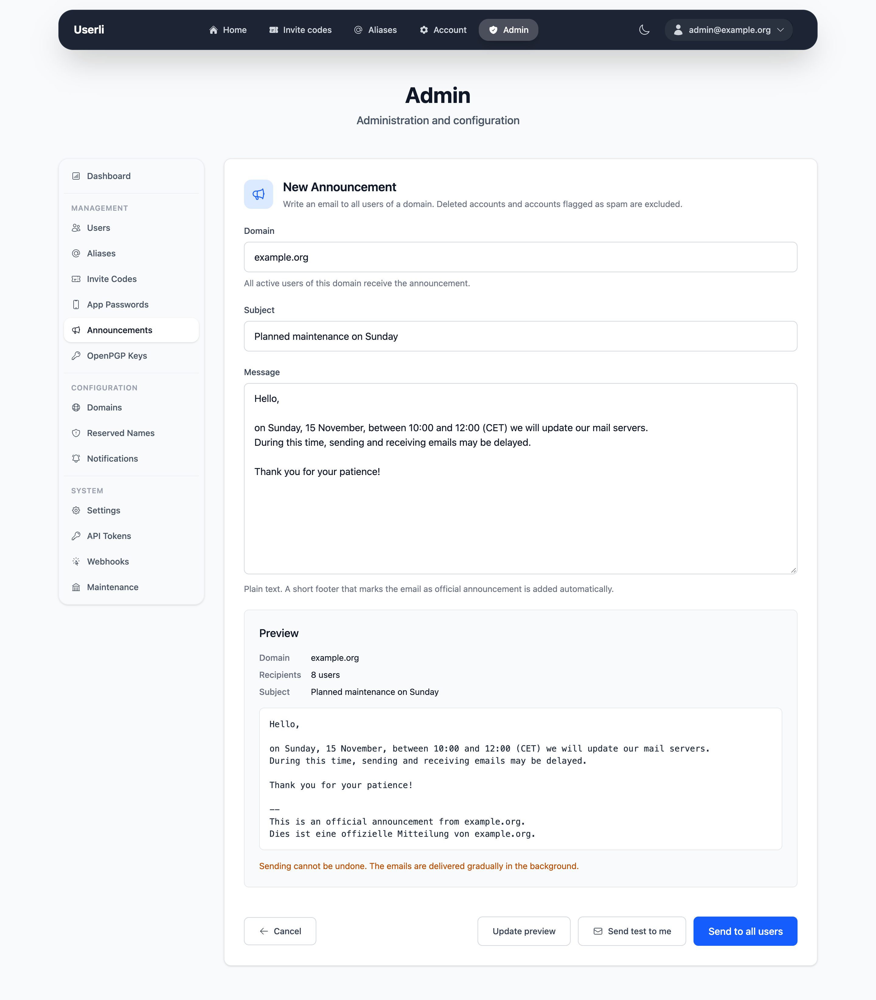

# Announcements

**Management → Announcements** sends an email to all active users of a domain,
for example to announce maintenance or changes to the service. Admins choose the
domain, domain admins can only write to the users of their own domain.

{class="screenshot"}

## Recipients

All users of the domain receive the announcement, except

* deleted accounts and
* accounts with the role [*Spam*](roles.md#spam).

Users who are deleted or flagged as spam after the announcement was sent, but
before their email went out, are skipped as well.

## Writing an announcement

1. Click **New Announcement**, choose the domain (admins only) and write subject
   and message. The message is sent as plain text.
2. Click **Preview**. The preview shows the email as users will receive it and
   the number of recipients. Userli adds a footer in English and German that
   marks the email as official announcement of your project (setting
   **Project name**).
3. Optionally, click **Send test to me** to receive the email at your own
   address.
4. Click **Send to all users**. If you changed the text after the preview, you
   have to check the updated preview first.

Sending can't be undone. Sent announcements are listed with author, number of
recipients, delivery progress and status:

| Status         | Meaning |
|----------------|---------|
| **Queued**     | The announcement is saved, the worker has not picked it up yet. |
| **Delivering** | The worker is sending the emails. The delivery column shows how many emails are sent, not sent and still pending. If the worker is interrupted, it continues where it stopped. |
| **Sent**       | Every email is either sent or not sent. |

Emails are **not sent** to users who were deleted or flagged as spam after the
announcement was created, and when the mail server rejected an email even after
several retries. Users who register while the announcement is being sent may or
may not receive it.

## Delivery

The emails are sent in the background by the [worker](../operations/background-services.md),
from the [sender address](settings.md#email-configuration). To avoid overloading
the mail server, at most **Announcement mails per minute** emails are sent per
minute (default `60`, see [Settings](settings.md#email-configuration)). An
announcement to 6000 users therefore takes about 100 minutes.
