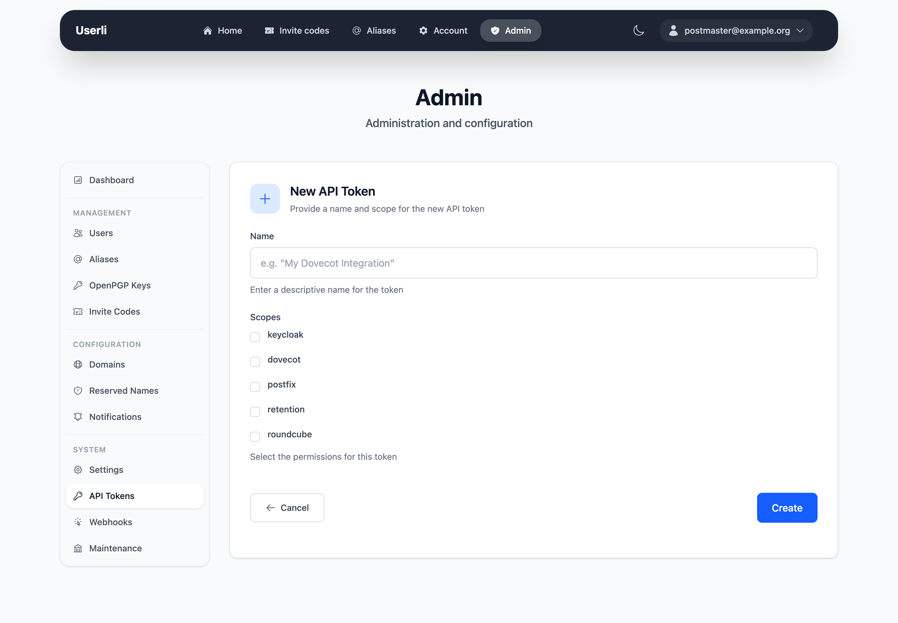

# API tokens

**System → API Tokens** (admins only) manages the tokens that other services –
Dovecot, Postfix, Roundcube, Keycloak – use to talk to Userli.

{class="screenshot"}

## Create a token

Click **Create**, enter a descriptive name (for example `Dovecot mx1`) and
select one or more scopes:

{class="screenshot"}

| Scope       | Used by |
|-------------|---------|
| `dovecot`   | [Dovecot](../operations/integrations/dovecot.md) – login and mailbox lookups |
| `postfix`   | [Postfix](../operations/integrations/postfix.md) – domains, mailboxes, aliases, SMTP auth |
| `roundcube` | [Roundcube](../operations/integrations/roundcube.md) – alias lookup |
| `keycloak`  | [Keycloak](../operations/integrations/keycloak.md) – single sign-on |
| `retention` | [Retention](../operations/integrations/retention.md) – activity of external services |

!!! warning "Copy the token immediately"

    The token is shown **only once** after creation. Userli only stores a hash.
    Hand it to your server operator through a secure channel.

## Good practice

* Create one token per service and server, with only the scopes it needs.
* The list shows when each token was last used. Delete unused tokens.
* If a token leaked, delete it and create a new one.
