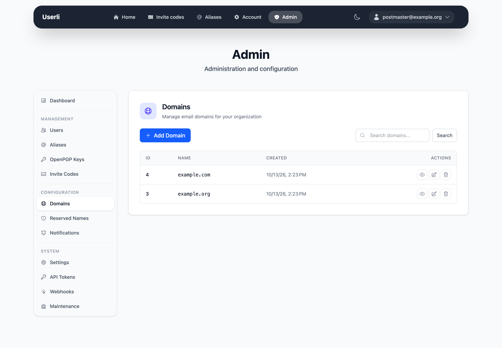
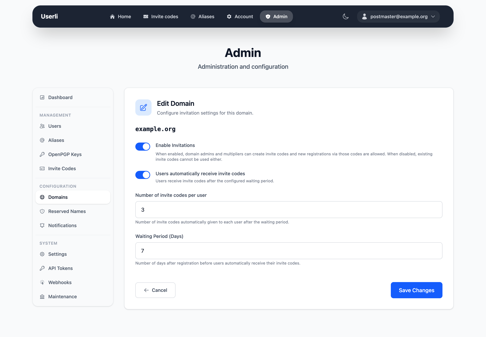

# Domains

**Configuration → Domains** lists the email domains managed by Userli. Only
admins can add and delete domains.

{class="screenshot"}

## Add a domain

Click **Create** and enter the domain name, for example `example.org`.

Userli only manages the accounts. Before users can receive mail on a new
domain, your server operator has to configure DNS (MX, SPF, DKIM, DMARC,
optionally [MTA-STS](../operations/mta-sts.md)) and the mail server for it.

### Default domain

The first domain you created (lowest ID) is the **default domain**:

* Users of this domain can sign in with only the part before the `@`.
* `bin/console app:admin:password` sets the password of
  `postmaster@<default domain>`.

## Domain details

The detail page shows the number of users, aliases, domain admins and invite
codes of the domain.

## Invitations

Registration in Userli works only with [invite codes](invite-codes.md).
Invitations are configured per domain under **Edit**:

{class="screenshot"}

| Setting            | Description |
|--------------------|-------------|
| **Enabled**        | Allow registration with invite codes for this domain. If disabled, visitors with a code see *"Registration closed"*. Existing accounts are not affected. |
| **Limit**          | Number of invite codes each user receives automatically. `0` means users don't get codes, but multipliers and admins can still create them. |
| **Waiting period** | Days after registration before users receive their codes (default 7). |

New domains have invitations disabled.

## Domain admins

Domain admins manage the users, aliases and invite codes of their own domain
and can edit its invitation settings via **Management → Domain settings**.

To make someone domain admin, give their account the role *Domain admin*. The
account must belong to the domain. See [Roles and permissions](roles.md).

## Delete a domain

!!! danger "Deletes all data of the domain"

    Deleting a domain **permanently** deletes all users, aliases, invite codes
    and OpenPGP keys of that domain. Unlike deleting a single user, this is a
    hard delete: the addresses become available again, and no `user.deleted`
    webhooks are sent.

Click *delete* and confirm with your password. You can't delete the domain of
your own account. Webhooks that were limited to only this domain are
disabled.

On the command line, use `bin/console app:domain:delete --domain example.org
--dry-run` to see what would be deleted first.
