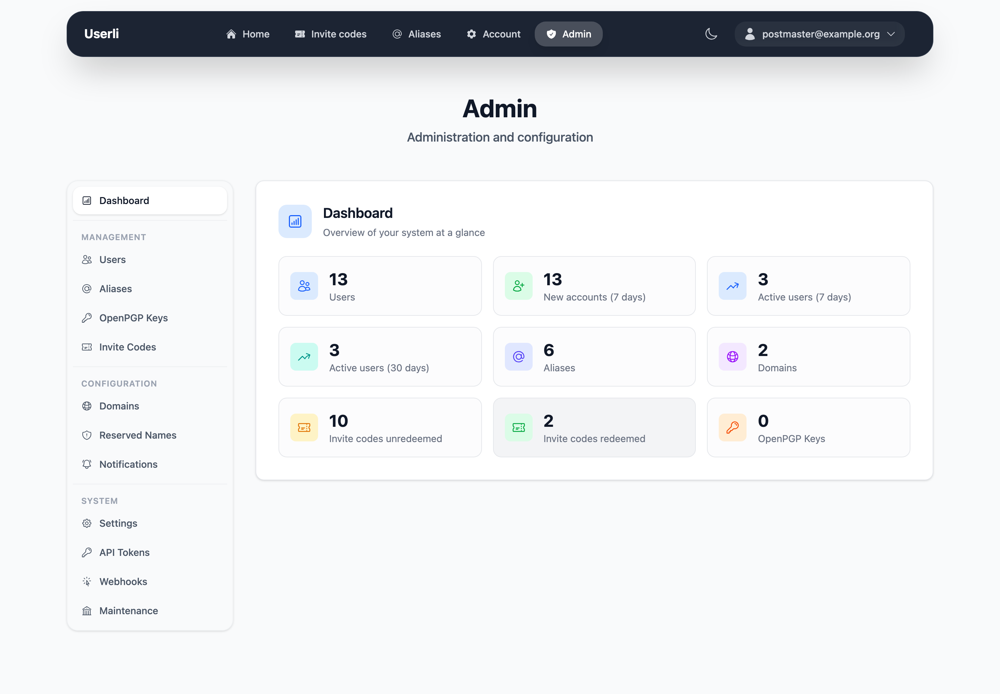
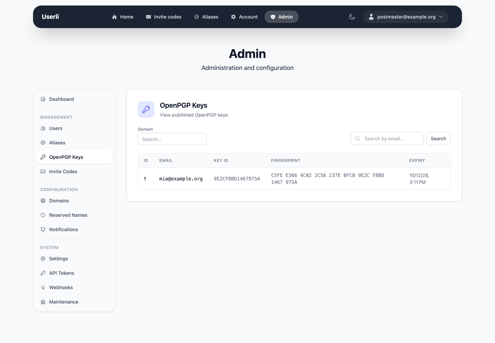

# Admin Guide

This guide is for people who manage the email accounts of a Userli
installation – either for all domains (**admins**) or for a single domain
(**domain admins**). It explains the admin interface. Installing and operating
the server is covered in [Operations](../operations/index.md).

## Open the admin interface

Sign in with an admin account and click **Admin** in the navigation bar, or open
`/admin/` directly.

{class="screenshot"}

The sidebar groups all pages:

| Group             | Pages                                                        | Admin | Domain admin |
|-------------------|--------------------------------------------------------------|:-----:|:------------:|
| **Management**    | Dashboard, [Users](users.md), [Aliases](aliases.md), OpenPGP Keys, [Invite Codes](invite-codes.md) | ✓ | ✓ (own domain) |
|                   | Domain settings ([own domain](domains.md#domain-admins))     |       | ✓            |
| **Configuration** | [Domains](domains.md), [Reserved Names](reserved-names.md), [Notifications](notifications.md) | ✓ |  |
| **System**        | [Settings](settings.md), [API Tokens](api-tokens.md), [Webhooks](webhooks.md), [Maintenance](maintenance.md) | ✓ |  |

!!! tip "Try it out"

    The screenshots in this guide were taken with the example data from
    `make fixtures`. See the [development setup](../development/index.md) to
    run your own test instance.

## Dashboard

The dashboard shows the number of users, new users and active users in the
last 7 and 30 days, aliases and published OpenPGP keys. Admins also see the
number of domains and redeemed and unused invite codes. Domain admins only see
numbers for their own domain.

## OpenPGP keys

**Management → OpenPGP Keys** is a read-only list of all keys that users have
published in the [Web Key Directory](../operations/wkd.md). Use the search to
find keys by email address or domain. Users manage their keys themselves, see
[OpenPGP keys](../user/openpgp.md) in the User Guide.

{class="screenshot"}

## Common tasks

| Task                                        | How                                                              |
|---------------------------------------------|------------------------------------------------------------------|
| Create an account for someone               | [Users → Create](users.md#create-a-user)                         |
| A user lost password **and** recovery token | [Set a new password](users.md#set-a-new-password) (encrypted mails are lost) |
| Account sends spam                          | [Add the role *Spam*](roles.md)                                  |
| Account invited spammers                    | [Add the role *Suspicious*](roles.md)                            |
| Delete a custom alias for a user            | [Aliases → Delete](aliases.md)                                   |
| Give someone unlimited invite codes         | [Add the role *Multiplier*](roles.md)                            |
| Open registration for a domain              | [Domains → Edit → Invitations](domains.md#invitations)           |
| Restore a deleted account                   | [Users → Restore](users.md#restore-a-user)                       |
