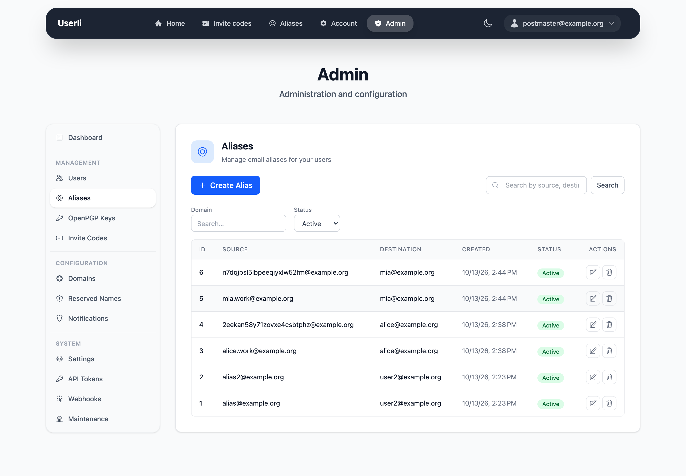
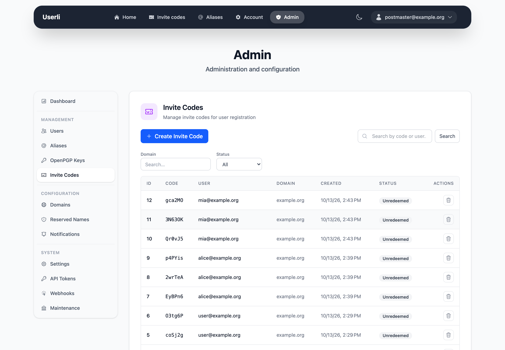
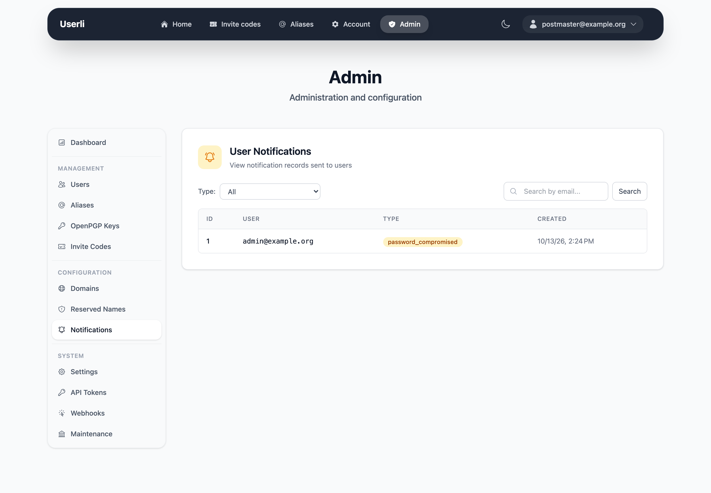
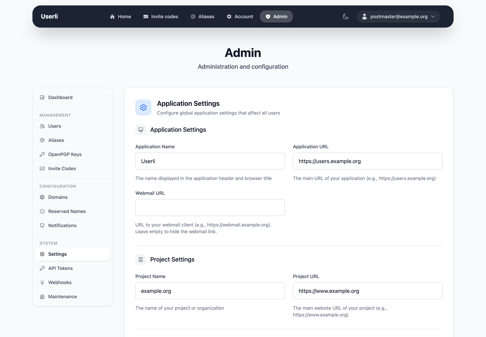
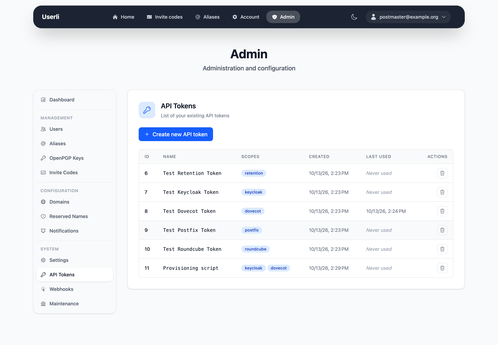
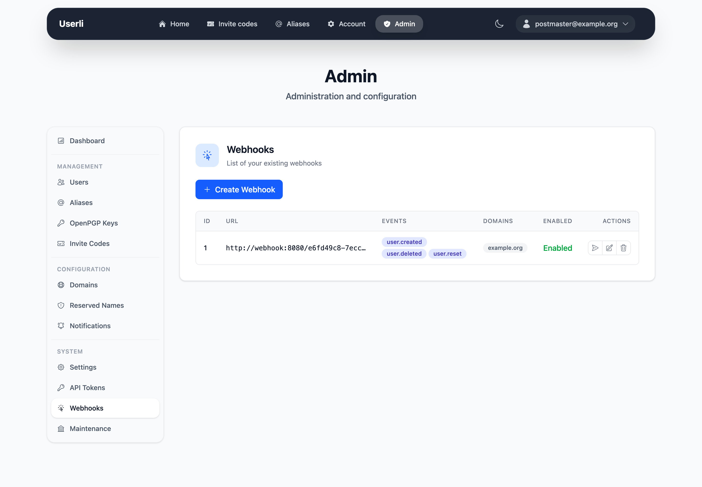

# Admin Guide

Userli ships with an admin interface for managing users, aliases, domains and
global settings. It is available under `/admin/` for users with the role
`ROLE_ADMIN` (and, with reduced scope, `ROLE_DOMAIN_ADMIN`). Once logged in,
use the **Admin** entry in the top navigation to open it.

The sidebar groups all admin pages into *Management*, *Configuration* and
*System*.

!!! tip

    The screenshots below were taken with the example data from `make fixtures`.
    See the [development setup](../development/index.md) to try it yourself.

## Dashboard

The dashboard gives an overview of the system: number of users, new accounts
and active users in the last 7 and 30 days, aliases, domains, invite codes and
published OpenPGP keys.

{class="screenshot"}

## Management

### Users

List, search, create, edit and delete user accounts. The list can be filtered
by domain, status (active/deleted), role, MailCrypt and 2FA state. Each row
shows the roles, whether 2FA and MailCrypt are enabled and the account status.
The actions per row are *show*, *edit* and *delete*. Deleted users can be
restored.

{class="screenshot"}

Available roles:

| Role                | Description                                          |
|---------------------|------------------------------------------------------|
| `ROLE_USER`         | Regular user                                         |
| `ROLE_ADMIN`        | Full access to the admin interface                   |
| `ROLE_DOMAIN_ADMIN` | Administrates the users and aliases of its own domain |
| `ROLE_SUSPICIOUS`   | Marks an account as suspicious; its invite codes are no longer valid |
| `ROLE_SPAM`         | Marks an account as spam sender (shown in the user list) |
| `ROLE_PERMANENT`    | Account is excluded from the removal of inactive users |
| `ROLE_MULTIPLIER`   | May create invite codes on demand, no waiting period|

### Aliases

Manage the email aliases (source and destination address) of all users. Aliases
can be filtered by domain and status.

{class="screenshot"}

### OpenPGP Keys

Read-only list of the OpenPGP keys published via the
[Web Key Directory](../features/wkd.md). Use the search to find keys by email
address or domain.

{class="screenshot"}

### Invite Codes

Create and delete invite codes (vouchers) for the registration. The list shows
the code, the user who owns it, the domain and whether it is already redeemed.

{class="screenshot"}

## Configuration

### Domains

Add the email domains that are managed by Userli. The domain with the lowest ID
(the first one created) acts as the default domain.

{class="screenshot"}

Per domain you can enable invitations. Registration with an invite code only
works for domains with invitations enabled; otherwise users see a "Registration
closed" page. Optionally users receive invite codes automatically after a
waiting period.

{class="screenshot"}

### Reserved Names

Local parts (the part before the `@`) that cannot be used for registration, for
example `admin` or `abuse`. Names can be added one by one, imported from a file
and exported.

{class="screenshot"}

### Notifications

Log of notifications that Userli has sent to users, for example when a
password was found in a database of compromised passwords. Filter by type or
search by email address.

{class="screenshot"}

## System

### Settings

Global settings that are stored in the database, such as application name and
URL, webmail URL, email sender addresses, SMTP quotas, MailCrypt and
[MTA-STS](../features/mta-sts.md). Changes apply immediately.

{class="screenshot"}

### API Tokens

Create tokens for the [integrations](../features/integrations.md). Every token
has one or more scopes (`keycloak`, `dovecot`, `postfix`, `retention`,
`roundcube`). A token is only shown once when it is created.

{class="screenshot"}

### Webhooks

Configure [webhooks](../features/webhooks.md) that are called on the events
`user.created`, `user.deleted` and `user.reset`, optionally limited to certain
domains. Use the *send* action to test an endpoint and inspect the deliveries
of an endpoint.

{class="screenshot"}

### Maintenance

Run maintenance tasks on demand, for example pruning old user notifications and
webhook deliveries, removing inactive users or cleaning up invite codes. The
same tasks are also executed regularly by the scheduler.

{class="screenshot"}
