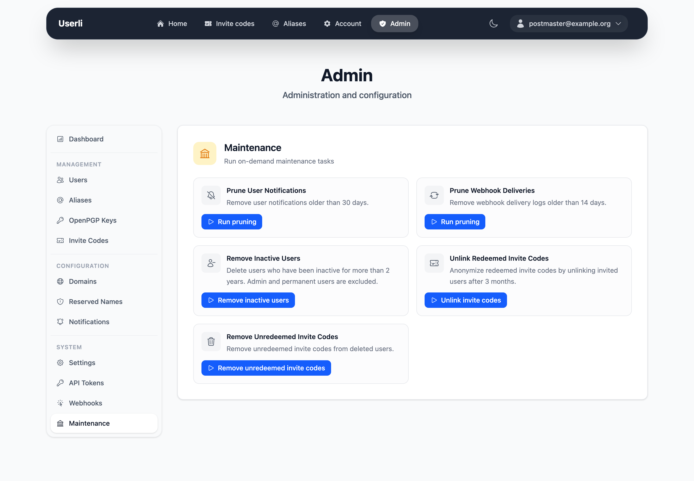

# Maintenance

Userli runs maintenance tasks automatically in the background. Under
**System → Maintenance** (admins only) you can start them manually, for example
after changing data or when the scheduler is not running.

{class="screenshot"}

| Task | Schedule | What it does |
|------|----------|--------------|
| **Prune expired app passwords** | daily, 02:30 | Removes expired webmail credentials. Can't be started manually. |
| **Prune expired security key challenges** | daily, 02:45 | Removes unused [security key](../operations/integrations/roundcube.md#security-keys) challenges that Userli issued for Roundcube logins. Expired ones are refused anyway. Can't be started manually. |
| **Prune webhook deliveries** | daily, 03:00 | Removes **successful** webhook deliveries older than 14 days. Failed ones are kept. |
| **Prune user notifications** | daily, 03:30 | Removes [notifications](notifications.md) older than 30 days. |
| **Unlink redeemed invite codes** | daily, 04:00 | Removes the link between an invite code and the account that used it, three months after registration. |
| **Remove unredeemed invite codes** | weekly, 05:00 | Removes unused invite codes of deleted users. |
| **Remove inactive users** | weekly, 06:00 | [Deletes](users.md#delete-a-user) accounts without sign-in for more than two years (737 days). Accounts with role *Admin*, *Domain admin* or *Permanent* are skipped. |
| **Weekly report** | weekly, 07:00 | Emails the registrations of the last 7 days to the notification address, if [enabled](settings.md#reports). Can't be started manually. |

Times are server time. Manually started tasks run in the background within a
few seconds.

!!! warning "Inactive users"

    Every sign-in counts – web interface, IMAP/POP3 via Dovecot, SMTP via
    Postfix or Keycloak. Services that keep users logged in for a long time
    should report activity via the
    [Retention API](../operations/integrations/retention.md), otherwise their
    users may be removed.

!!! note

    The tasks only run automatically if the worker and scheduler processes are
    running, see [Background services](../operations/background-services.md).
