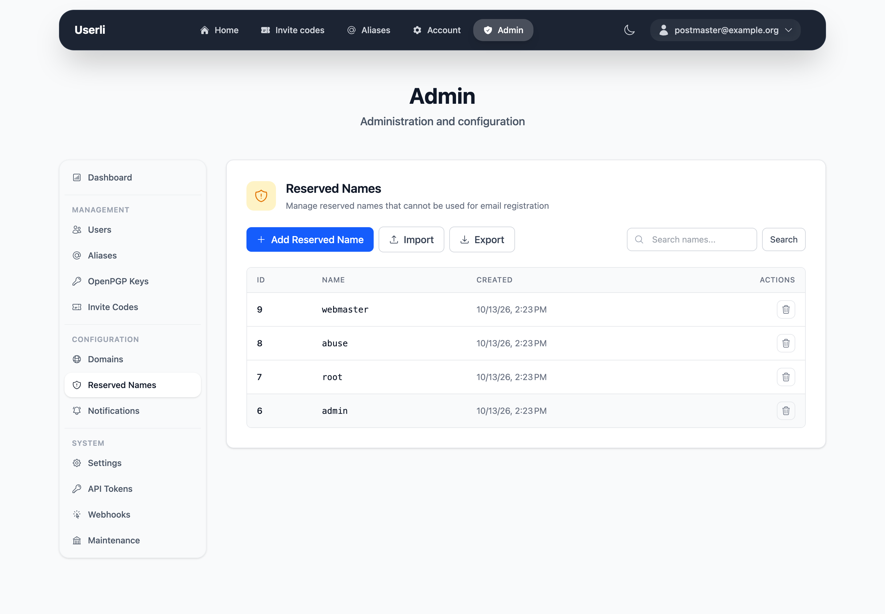

# Reserved names

**Configuration → Reserved Names** (admins only) lists names that can't be
registered or used as alias, for example `admin`, `abuse`, `postmaster` or
`support`. A reserved name blocks the part before the `@` on **all** domains.

{class="screenshot"}

* **Create** adds a single name.
* **Delete** removes a name.
* **Import** adds names from a text file.
* **Export** downloads all names as `reserved_names.txt`.

## Import format

A plain text file (up to 1 MB) with one name per line. Empty lines and lines
starting with `#` are ignored, names are converted to lowercase, and existing
names are skipped.

```text
# Common role addresses
admin
hostmaster
webmaster
```

A curated list of about 570 common names is available at
[`contrib/reserved_names.txt`](https://github.com/systemli/userli/blob/main/contrib/reserved_names.txt).
Import it right after the [initial setup](../operations/initial-setup.md).

Reserved names don't affect existing accounts or aliases.
