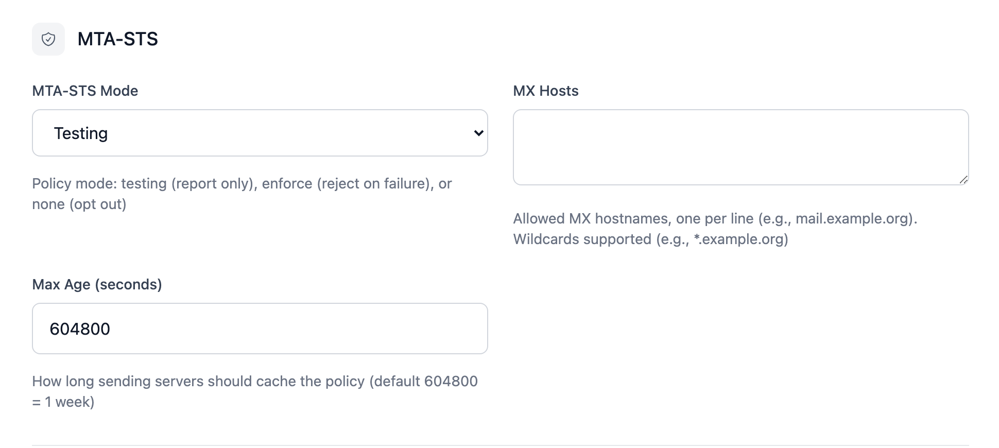

# Settings

**System → Settings** (admins only) contains the global settings of the
installation. They are stored in the database and apply immediately. The
basic settings are first set in the [setup wizard](../operations/initial-setup.md#setup-wizard).

{class="screenshot"}

## Application settings

| Setting         | Default                     | Description |
|-----------------|-----------------------------|-------------|
| **App name**    | `Userli`                    | Name in the header, browser title and start page (3–30 characters). |
| **App URL**     | `https://users.example.org` | Public URL of Userli. Used in links in emails and invite links. |
| **Webmail URL** | –                           | URL of your webmail. Shows a *Webmail* card to users. Leave empty to hide it. |

## Project settings

| Setting          | Default                  | Description |
|------------------|--------------------------|-------------|
| **Project name** | `example.org`            | Name of your project or organization, used on the welcome page and in emails. |
| **Project URL**  | `https://www.example.org` | Website of your project. |

## Email configuration

| Setting                        | Default                  | Description |
|--------------------------------|--------------------------|-------------|
| **Sender address**             | `admin@example.org`      | Sender of all emails from Userli. |
| **Notification address**       | `monitoring@example.org` | Receives the weekly report and reports about suspicious users. |

## Mailbox encryption

| Setting       | Default | Description |
|---------------|---------|-------------|
| **MailCrypt** | `2`     | `0` disabled, `1` optional, `2` enforce for new users, `3` enforce for all users. |

{class="screenshot"}

See [MailCrypt](../operations/mailcrypt.md) for what the levels mean and how to
migrate existing users. Keep the default unless you know why to change it.

## Reports

| Setting           | Default | Description |
|-------------------|---------|-------------|
| **Weekly report** | on      | Every week, send a list of new registrations to the notification address. |

## SMTP quota limits

| Setting      | Default | Description |
|--------------|---------|-------------|
| **Per hour** | `0`     | Default maximum number of emails a user can send per hour. `0` = unlimited. |
| **Per day**  | `0`     | Default maximum number of emails a user can send per day. `0` = unlimited. |

Limits can be overridden per [user](users.md) and per [alias](aliases.md).
Userli only provides the numbers – your mail server has to enforce them, see
[Postfix](../operations/integrations/postfix.md).

## MTA-STS

| Setting     | Default   | Description |
|-------------|-----------|-------------|
| **Mode**    | `testing` | `testing` (report only), `enforce` (reject on failure) or `none` (opt out). |
| **MX hosts** | –        | Allowed MX hostnames, one per line, wildcards like `*.example.org` allowed. |
| **Max age** | `604800`  | How long (in seconds) sending servers cache the policy. 1 day to 1 year. |

{class="screenshot"}

No policy is published while the MX list is empty. See
[MTA-STS](../operations/mta-sts.md) for the required DNS records.

## RFC email addresses

| Setting               | Default | Description |
|-----------------------|---------|-------------|
| **Postmaster address** | –      | Destination of `postmaster@` on **all** domains ([RFC 5321](https://datatracker.ietf.org/doc/html/rfc5321)). |
| **Abuse address**     | –       | Destination of `abuse@` on **all** domains ([RFC 2142](https://datatracker.ietf.org/doc/html/rfc2142)). |

If set, these override aliases with the same address. Leave empty to use
aliases instead.
