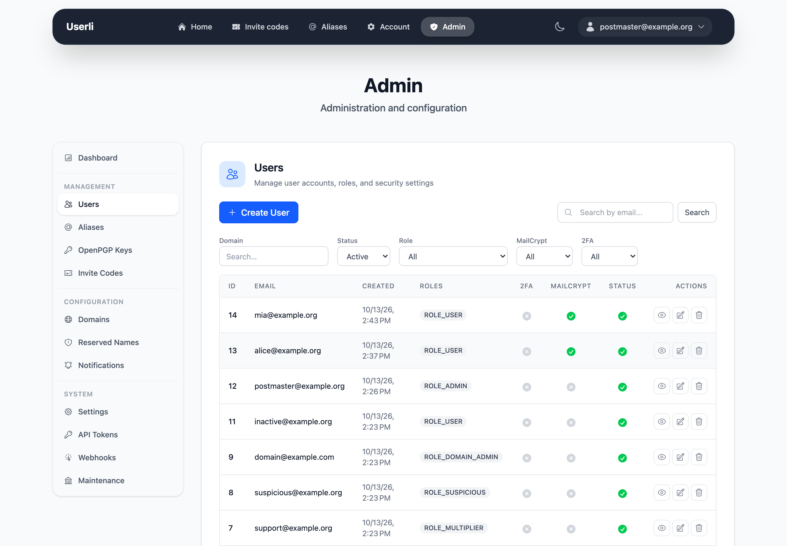
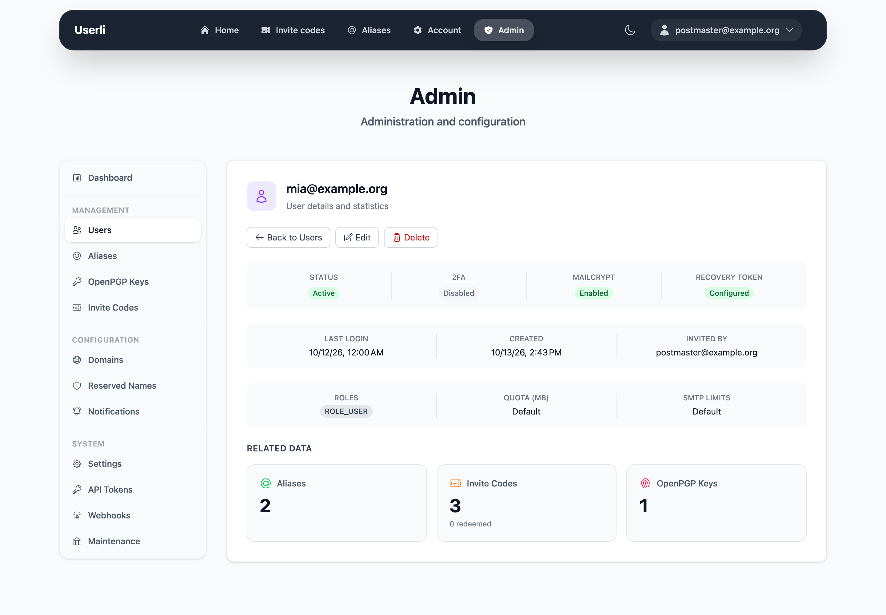

# Users

**Management → Users** lists all accounts. Domain admins only see the accounts
of their own domain.

{class="screenshot"}

* **Search** by email address.
* **Filter** by status (active, deleted, all), role, MailCrypt, two-factor
  authentication and domain.
* The list shows roles, whether 2FA and MailCrypt are enabled and whether the
  account is deleted.
* Actions per row: *show*, *edit*, *delete* – or *restore* for deleted
  accounts.

## Show a user

{class="screenshot"}

The detail page shows roles, status, MailCrypt and 2FA state, creation and last
sign-in date, and the number of aliases, invite codes, redeemed invite codes
and OpenPGP keys. It also warns if the user's password was found in a data
breach recently.

## Create a user

Click **Create** and fill in:

| Field                     | Description |
|---------------------------|-------------|
| **Email**                 | Full address. The domain must exist. Domain admins can only use their own domain. Can't be changed later. |
| **Password**              | At least 12 characters, not found in known data breaches. |
| **Roles**                 | See [Roles and permissions](roles.md). *User* is always added. |
| **Quota**                 | Optional mailbox size limit in **MB**. Passed to Dovecot. Empty means no limit. |
| **SMTP quota limits**     | Optional maximum number of emails per hour and per day (admins only). Empty uses the [global default](settings.md#smtp-quota-limits). |
| **Password change required** | The user must choose a new password at the next sign-in. Always set for new users. |

Users created in the admin interface:

* must change the password before they can use email (web, IMAP, SMTP),
* get mailbox encryption keys if MailCrypt is enforced
  ([setting `mail_crypt` ≥ 2](settings.md#mailbox-encryption)),
* don't have a recovery token yet – ask them to
  [create one](../user/security.md#create-a-new-recovery-token),
* don't receive a welcome email and don't trigger the `user.created` webhook.

!!! tip

    For self-registration, create an [invite code](invite-codes.md) instead and
    send the user the registration link.

## Edit a user

The same fields as above, except the email address. Additionally:

* **Two-factor authentication:** uncheck to turn off 2FA for a user who lost
  their phone and backup codes.

### Set a new password

Enter a password only if the user can't help themselves – they lost both their
password and their [recovery token](../user/recovery.md).

!!! danger "Encrypted emails are lost"

    If the user has MailCrypt keys, setting a new password **resets** the
    account:

    * new MailCrypt keys are generated – all existing emails become
      unreadable,
    * a new recovery token is created and shown to you once – pass it on to
      the user securely,
    * two-factor authentication is turned off,
    * the `user.reset` [webhook](webhooks.md) is sent.

    The user has to change the password at the next sign-in.

## Delete a user

Deleting is a **soft delete**. The account remains in the database so that the
address can never be registered again, but:

* the password is replaced by a random one, recovery token and MailCrypt keys
  are erased,
* all aliases of the user are deleted,
* unused invite codes and notifications are removed,
* the published OpenPGP key is removed,
* the `user.deleted` [webhook](webhooks.md) is sent.

The mailbox on the mail server is **not** deleted by Userli. Your server
operator can do this with the
[mailbox janitor](../operations/integrations/mailbox-janitor.md).

## Restore a user

Filter by status *deleted* and click **restore** on a deleted account. Set a
new password. Userli

* reactivates the account,
* creates new MailCrypt keys and a new recovery token (shown once),
* sends the welcome email.

Old encrypted emails can't be read anymore and aliases are not restored.
