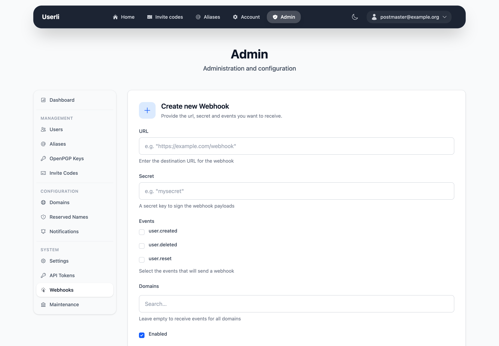
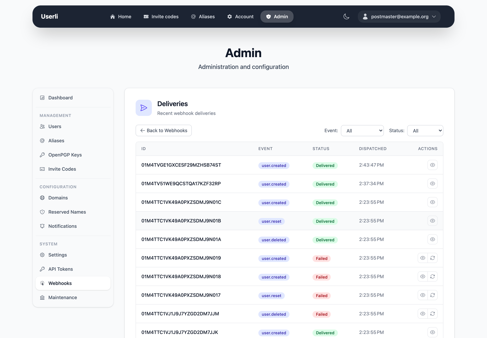

# Webhooks

**System → Webhooks** (admins only) configures URLs that Userli calls when
accounts are created, deleted or reset. Webhooks keep other services – for
example Nextcloud, Matrix or a script on the mail server – in sync with Userli.

{class="screenshot"}

## Create a webhook

Click **Create** and fill in:

{class="screenshot"}

| Field       | Description |
|-------------|-------------|
| **URL**     | Endpoint that receives the events. |
| **Secret**  | Shared secret to sign the requests. The receiver needs the same secret. |
| **Events**  | At least one of `user.created`, `user.deleted`, `user.reset`. |
| **Domains** | Optional. Only send events for users of these domains. Empty means all domains. |
| **Enabled** | Turn the webhook on or off. |

| Event          | Sent when |
|----------------|-----------|
| `user.created` | A user registered with an invite code. |
| `user.deleted` | A user was deleted – by themselves, an admin or automatic cleanup. |
| `user.reset`   | An admin set a new password for a user with mailbox encryption. |

## Test and monitor

* Use the **send** action to send a test event.
* **Deliveries** lists all calls of a webhook with status, response and number
  of attempts. Failed deliveries are retried automatically three times. You can
  retry a delivery manually after fixing the receiver.

{class="screenshot"}

Successful deliveries are removed after 14 days.

The payload format, signature and retry behaviour are described for developers
of receivers in [Operations → Webhooks](../operations/integrations/webhooks.md).
