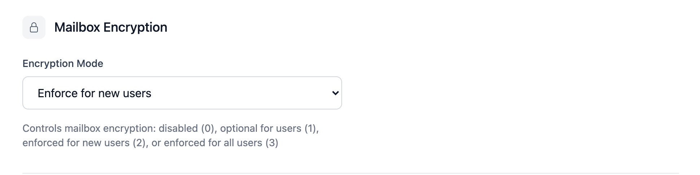

# MailCrypt

The software has builtin support for
[Dovecot's mailbox encryption](https://doc.dovecot.org/main/core/plugins/mail_crypt.html), using the
[global keys mode](https://doc.dovecot.org/main/core/plugins/mail_crypt.html#global-keys).
Keys are created and maintained by userli and handed over via an API and can
be consumed by Dovecot by a Lua script. See [here](../installation/dovecot.md)
for how to configure authentication and mailcrypt in Dovecot.

MailCrypt is configured globally in the admin interface under
**Admin → Settings → Mailbox Encryption** (setting `mail_crypt`, default `2`).
The following values are supported:

* `0` - Disable MailCrypt globally
* `1` - Allow to use MailCrypt, needs to be enabled manually for new users
* `2` - Enforce MailCrypt key generation for new users
* `3` - Enforce MailCrypt key generation for all users, see the
  documentation about migrating legacy users for more info

{class="screenshot"}

The admin interface shows for every user whether MailCrypt is enabled:

{class="screenshot"}

MailCrypt can be turned on/off for individual users by setting the `mail_crypt`
switch in the `users` database table. This switch is mainly meant to
provide a migration path from legacy users without MailCrypt keys. On new
setups, it's recommended to keep MailCrypt enabled for all users.

## Implementation details

We use elliptic curve keys with curve secp521r1. The private key is encrypted
with a libargon2i hash of the users' password, stored in a libsodium secret
box.

A second copy of the private key is stored encrypted with a libargon2i hash of
the users' recovery token, to be used when a user restores their account after
they lost their password.

## Migrating legacy users

Legacy users (without MailCrypt keys) continue to work without mailbox
encryption. If they generate a recovery token manually in the account settings,
a MailCrypt key pair gets created for them. This doesn't enable MailCrypt for
them automatically, though. Reason is that this would result in acounts with
partially unencrypted (the old) and partially encrypted (the new) mails.
Therefore we decided to leave the exercise to enable MailCrypt for legacy
users who got a MailCrypt key pair generated in the meantime to the system
admins (e.g. by a cron script).

In order to enable MailCrypt for a legacy user, do the following:

1. Ensure that they have a recovery token generated. This will automatically
   generate MailCrypt key pair as well. This step can only be done by the
   account holder, as the user password is required to do so.
2. Manually set `mail_crypt=1` for the user in the `users` database
   table. This needs to be done on a per-user basis on purpose (e.g. by a
   cron script).

Or, alternatively, to enforce MailCrypt for all legacy users:

1. Set the MailCrypt setting to `3` in **Admin → Settings**. This will result in a
   MailCrypt key pair being generated automatically when legacy users log
   in the next time. Again, we cannot do this step without the user logging
   in, as the user password is required to do so.
2. Manually set `mail_crypt=1` for all users in the `users` database
   table that have a MailCrypt key pair generated but MailCrypt not enabled
   yet. This needs to be done on a per-user basis on purpose (e.g. by a cron
   script).

Please note that existing mails will not be encrypted automatically. Instead,
all existing mail stays unencrypted and only new incoming mail will be stored
encrypted.

The following SQL statement can be used to enable MailCrypt for all legacy
users that got a MailCrypt key pair generated. Use with caution!

```sql
UPDATE users SET mail_crypt=1 WHERE mail_crypt_secret_box IS NOT NULL AND mail_crypt = 0;
```
