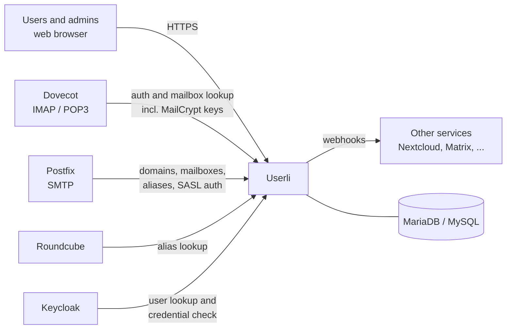

# Userli

**Userli** is a free and open-source web application to (self-) manage email
accounts and encrypt their mailboxes. It is developed by
[systemli.org](https://www.systemli.org), a non-profit tech collective that
runs it for its own email service, and released under the
[AGPL v3](https://github.com/systemli/userli/blob/main/LICENSE).

Userli is the user database and self-service portal of a mail server. It does
not send or store emails itself. Instead, [Dovecot](https://www.dovecot.org/)
and [Postfix](https://www.postfix.org/) ask Userli who is allowed to log in,
which addresses exist and where mail has to go.

{class="screenshot"}

## Who is this documentation for?

-   :material-account:{ .lg .middle } **Users**

    ---

    You have (or want) an email account on a server that runs Userli. Learn
    how to register, sign in, protect your account and manage aliases.

    [:octicons-arrow-right-24: User Guide](user/index.md)

-   :material-shield-account:{ .lg .middle } **Admins and domain admins**

    ---

    You manage the accounts of a mail service or of a single domain. Learn how
    to manage users, aliases, invite codes, domains and settings.

    [:octicons-arrow-right-24: Admin Guide](admin/index.md)

-   :material-server:{ .lg .middle } **Server operators**

    ---

    You install and operate Userli and connect it to Postfix, Dovecot and
    other services.

    [:octicons-arrow-right-24: Operations](operations/index.md)

-   :material-code-braces:{ .lg .middle } **Developers**

    ---

    You want to fix a bug, build a feature, translate or improve these docs.

    [:octicons-arrow-right-24: Development](development/index.md)

## Features

**For users**

* Registration with invite codes – existing users invite new users
* Self-service: change password, create aliases, delete the account
* Custom and random alias addresses
* Two-factor authentication (TOTP) with backup codes
* Recovery token to regain access after losing the password
* Publishing OpenPGP keys via [Web Key Directory](operations/wkd.md)
* Available in English, German, Spanish, French, Italian, Portuguese, Bokmål
  and Swiss German

**For admins**

* Web interface for users, aliases, domains, invite codes, reserved names,
  settings, API tokens and webhooks
* Multiple domains with [domain admins](admin/roles.md) who only see their
  own domain
* Roles to mark accounts as spam or suspicious, or to protect them from the
  removal of inactive accounts
* Automatic maintenance: removal of inactive accounts, cleanup of old data,
  weekly registration report

**For operators**

* Mailbox encryption with [Dovecot MailCrypt](operations/mailcrypt.md) – keys
  are protected with the user's password
* HTTP APIs for [Dovecot, Postfix, Roundcube, Keycloak](operations/integrations/index.md)
  and more, secured with scoped API tokens
* [Webhooks](operations/integrations/webhooks.md) to keep other services in sync
* [MTA-STS](operations/mta-sts.md) policy hosting
* Prometheus metrics

## How it fits together

Userli is a [Symfony](https://symfony.com/) application written in PHP. It
stores its data in MariaDB or MySQL and uses a background worker for emails,
webhooks and recurring maintenance tasks.

## Get involved

Userli is free software and contributions are very welcome: code,
[translations](https://hosted.weblate.org/engage/userli/), bug reports and
documentation.

* Source code and issues: [github.com/systemli/userli](https://github.com/systemli/userli)
* Good first issues: [issue tracker](https://github.com/systemli/userli/labels/good%20first%20issue)
* Start here: [Development](development/index.md)

Everyone involved is expected to follow our
[Code of Conduct](development/code_of_conduct.md).
