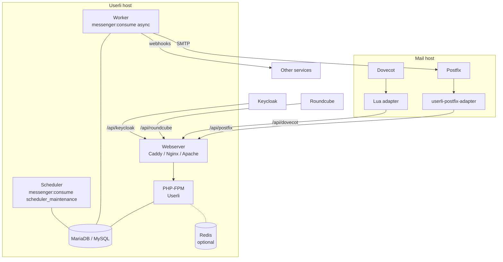

# Operations

This part is for people who install and run Userli on a server and connect it
to the mail server. You should be familiar with Linux administration, a
webserver with PHP, MariaDB/MySQL and the basics of Postfix and Dovecot.

## Architecture

Userli is the account database and self-service portal of a mail system. It
never touches mail directly: the mail server asks Userli via HTTP APIs.

| Component | Purpose |
|-----------|---------|
| **Web application** | PHP application behind a webserver. Serves the user and admin interface, the APIs, the [Web Key Directory](wkd.md) and [MTA-STS](mta-sts.md) policies. |
| **Database** | MariaDB or MySQL. Stores users, aliases, domains, settings and the message queue. |
| **Worker** | Sends emails and webhooks asynchronously. |
| **Scheduler** | Triggers recurring [maintenance tasks](../admin/maintenance.md). |
| **Redis** | Optional shared cache – recommended when running several instances or containers. |
| **Dovecot** | Authenticates IMAP/POP3 users and gets mailbox encryption keys from Userli via a [Lua adapter](integrations/dovecot.md). |
| **Postfix** | Looks up domains, mailboxes, aliases, senders and SMTP quotas and authenticates SMTP users via the [Postfix adapter](integrations/postfix.md). |

## Where to start

1. Check the [requirements](requirements.md).
2. Install Userli [from a release tarball](installation.md).
3. [Configure](configuration.md) it, set up the [webserver](webserver.md) and
   the [background services](background-services.md).
4. Run the [initial setup](initial-setup.md).
5. Connect [Dovecot](integrations/dovecot.md) and
   [Postfix](integrations/postfix.md).
6. Plan [updates](updating.md), [backups](backup.md) and
   [monitoring](monitoring.md), and review the [security notes](security.md).

The day-to-day management of users and domains in the web interface is
described in the [Admin Guide](../admin/index.md).
