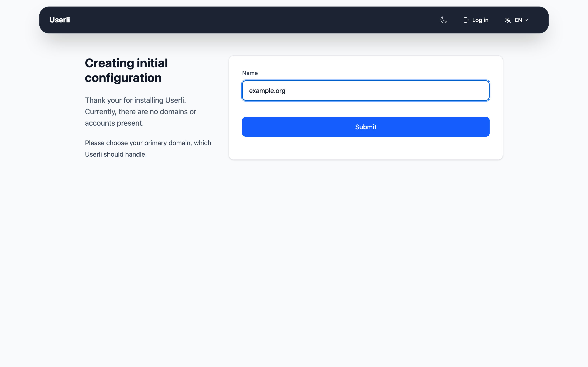
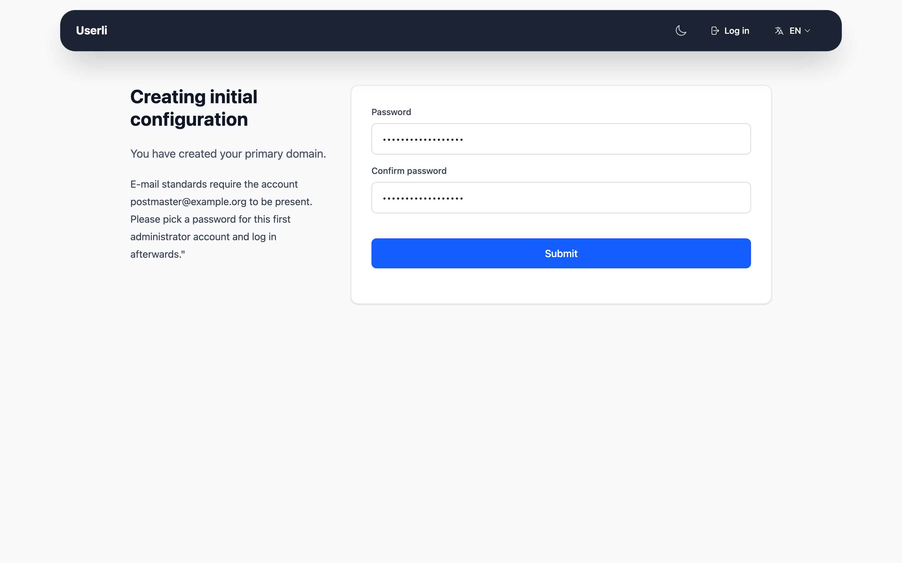

# Initial setup

After [installing](installation.md) Userli, creating the database schema and
configuring the [webserver](webserver.md) and the
[background services](background-services.md), finish the setup in the
browser.

## Setup wizard

Open Userli in your browser. As long as no domain exists, you are redirected to
the setup wizard at `/init`, which guides you through three steps:

1. Create the first mail domain. It becomes the
   [default domain](../admin/domains.md#default-domain).

    {class="screenshot"}

2. Set the password of the first admin account `postmaster@<domain>`.

    {class="screenshot"}

3. Configure the basic [settings](../admin/settings.md). The form is
   prefilled based on the domain, for example `https://users.<domain>` as
   App URL and `noreply@<domain>` as sender address. Check at least:

    * **App name** and **App URL**
    * **Project name** and **Project URL**
    * **Sender address** and **Notification address**
    * **Webmail URL**, if you offer webmail
    * **Postmaster address** and **Abuse address**

Afterwards, sign in with the admin account. All settings can be changed later
in **Admin → Settings**.

You can also set the admin password on the command line:

```shell
bin/console app:admin:password
```

## Import reserved names

Prevent users from registering addresses like `admin` or `abuse`: import the
curated list
[`contrib/reserved_names.txt`](https://github.com/systemli/userli/blob/main/contrib/reserved_names.txt)
in **Admin → Reserved Names → Import**. See
[Reserved names](../admin/reserved-names.md).

## Enable invitations

New users can only register with invite codes. Enable invitations for your
domain in **Admin → Domains → Edit** and create the first invite codes. See
[Invite codes](../admin/invite-codes.md).

## Connect the mail server

* [Dovecot](integrations/dovecot.md) – authentication and mailbox encryption
* [Postfix](integrations/postfix.md) – domains, mailboxes, aliases, SMTP
  authentication

## Removing mailboxes of deleted users

Userli has no access to the mailboxes on the mail server (usually owned by the
system user `vmail`) and therefore does not delete them. To remove the mailbox
of a deleted account, react to the `user.deleted`
[webhook](integrations/webhooks.md) on the mail server. The
[mailbox janitor](integrations/mailbox-janitor.md) does this for you and also
purges mailboxes of reset accounts.

## Checklist

- [ ] Background services (worker and scheduler) are running
- [ ] Settings reviewed
- [ ] Reserved names imported
- [ ] Dovecot and Postfix connected and tested
- [ ] [Backups](backup.md) configured
- [ ] [Monitoring](monitoring.md) configured
