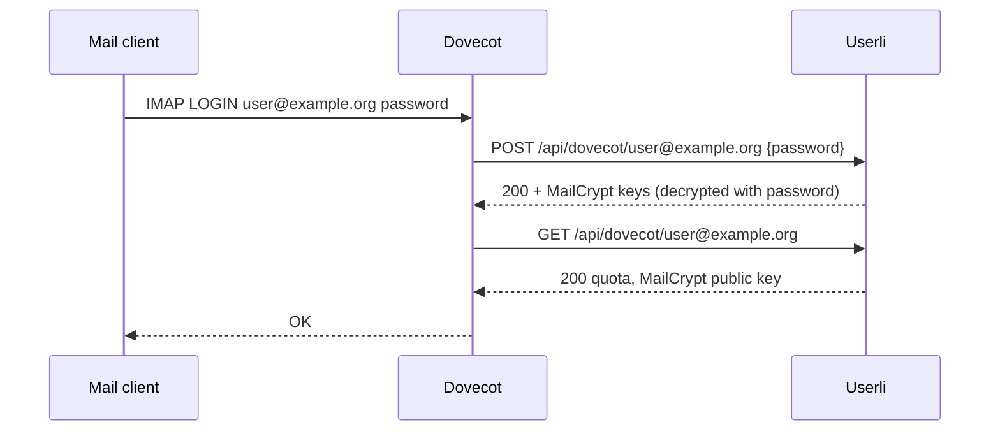

# Dovecot

Dovecot asks Userli to authenticate IMAP/POP3 users (`passdb`) and to look up
mailbox details (`userdb`): quota and – if [MailCrypt](../mailcrypt.md) is
enabled – the encryption keys.

The connection is made by a Lua script, the **Userli Dovecot adapter**. It is
released as a separate tarball with every Userli release
(`userli-dovecot-adapter-x.y.z.tar.gz`). The adapter is only guaranteed to be
compatible with the same Userli version and requires **Dovecot 2.4**.



## On the Userli host

Create an API token with the scope `dovecot`:

* in the admin interface under **Admin → API Tokens**, or
* on the command line:

    ```shell
    bin/console app:api-token:create --name "Dovecot" --scopes dovecot
    ```

## On the Dovecot host

### Install Lua dependencies

On Debian based systems, run

```shell
sudo apt update
sudo apt install lua5.4 lua-json dovecot-auth-lua
```

### Install the adapter

Install the adapter script to a suitable location, like `/usr/local/bin/`:

```shell
cd /usr/local/bin/
wget https://github.com/systemli/userli/releases/download/x.y.z/userli-dovecot-adapter-x.y.z.tar.gz
# Check signature and hash sum, see "Install from release"
tar -xvzf userli-dovecot-adapter-x.y.z.tar.gz
```

### Environment variables

| Variable                   | Default                  | Description |
|----------------------------|--------------------------|-------------|
| `USERLI_API_ACCESS_TOKEN`  | –                        | **Required.** Plain API token with the `dovecot` scope. |
| `USERLI_HOST`              | –                        | **Required.** Host (and optional port) of Userli, without scheme and path, e.g. `users.example.org`. |
| `DOVECOT_LUA_INSECURE`     | `false`                  | Use plain HTTP instead of HTTPS. Only for local testing. |
| `DOVECOT_LUA_MAX_ATTEMPTS` | `3`                      | Number of attempts per request. |
| `DOVECOT_LUA_TIMEOUT`      | `10000`                  | Timeout per request in milliseconds. |
| `DOVECOT_LUA_AGENT`        | `Userli-Dovecot-Adapter` | HTTP user agent. |

Set them in the environment of the Dovecot service, for example with a systemd
drop-in:

```ini title="/etc/systemd/system/dovecot.service.d/userli.conf"
[Service]
Environment=USERLI_HOST=users.example.org
Environment=USERLI_API_ACCESS_TOKEN=<PLAIN_TOKEN>
```

### Authentication

```text title="/etc/dovecot/conf.d/auth-lua.conf.ext"
# Any of the above env vars needs to be explicitly imported here,
# in order to be available to the adapter script:
import_environment {
  USERLI_API_ACCESS_TOKEN=
  USERLI_HOST=
}

passdb lua {
  driver = lua
  lua_file = /usr/local/bin/userli-dovecot-adapter.lua
}

userdb lua {
  driver = lua
  lua_file = /usr/local/bin/userli-dovecot-adapter.lua
}
```

Include it in your Dovecot configuration with
`!include conf.d/auth-lua.conf.ext` and disable other `passdb`/`userdb`
sections.

### Mail location

Store mails in a separate directory per user, for example:

```text title="/etc/dovecot/conf.d/10-mail.conf"
mail_home = /srv/vmail/%{user|domain}/%{user|username}
mail_driver = maildir
mail_path = ~/Maildir
mail_uid = vmail
mail_gid = vmail
```

## MailCrypt

To enable [mailbox encryption](../mailcrypt.md), enable the `mail_crypt`
plugin, but disable encryption by default:

```text title="/etc/dovecot/conf.d/90-mail-crypt.conf"
mail_plugins {
    mail_crypt = yes
}

crypt_write_algorithm =
```

The empty `crypt_write_algorithm` disables encryption by default. This is
necessary to not break incoming mail for users without MailCrypt keys. The
adapter sets the algorithm and the keys for every user with MailCrypt enabled.

## Test

```shell
doveadm auth test user@example.org
doveadm user user@example.org
```

See the Dovecot documentation on
[Lua authentication](https://doc.dovecot.org/latest/core/config/auth/databases/lua.html)
and [debugging authentication](https://doc.dovecot.org/main/core/admin/debugging/debugging_authentication.html).
