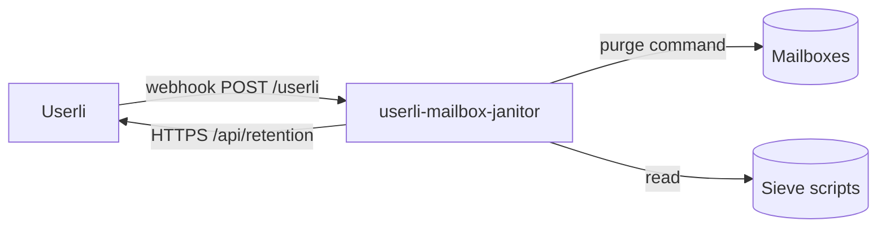

# Mailbox janitor

Userli has no access to the mailboxes on the mail server and therefore doesn't
delete or reset them. The
[userli-mailbox-janitor](https://github.com/systemli/userli-mailbox-janitor)
is a small Go service running on the Dovecot host that does this for you:

* **Delete mailboxes** of deleted users after a retention period
  (`user.deleted` [webhook](webhooks.md)).
* **Purge mailboxes** of reset users immediately (`user.reset` webhook). After
  a reset, old emails can't be decrypted anymore, so they are removed.
* **Keep forwarding-only accounts alive:** users whose Sieve script redirects
  all mail never sign in. The janitor reports them as active via the
  [Retention API](retention.md), so they aren't removed as inactive.



## On the Userli host

Create an API token with the scope `retention`:

```shell
bin/console app:api-token:create --name "Mailbox janitor mx1" --scopes retention
```

Create a webhook endpoint in **Admin → Webhooks** (see
[Admin Guide → Webhooks](../../admin/webhooks.md)):

* **URL:** `https://<janitor-host>/userli`
* **Events:** `user.deleted` and `user.reset`
* **Secret:** a random string, used as `WEBHOOK_SECRET` below

## On the mail server

Download a binary for your platform from the
[releases](https://github.com/systemli/userli-mailbox-janitor/releases) or
build it from source:

```shell
git clone https://github.com/systemli/userli-mailbox-janitor.git
cd userli-mailbox-janitor
go build -o userli-mailbox-janitor
```

Configure it with environment variables and run it as a service, for example
with systemd as the `vmail` user:

```shell
WEBHOOK_SECRET=<WEBHOOK_SECRET>
USERLI_URL=https://userli.example.org
USERLI_TOKEN=<PLAIN_TOKEN>
PURGER_DATABASE_PATH=/var/lib/userli-mailbox-janitor/mailboxes.csv
PURGER_COMMAND="rm -rf /var/vmail/{domain}/{local_part}"
TOUCHER_SIEVE_LOCATION=/var/vmail/{domain}/{local_part}/.dovecot.sieve
```

| Variable | Default | Description |
|----------|---------|-------------|
| `WEBHOOK_SECRET` | – (required) | Secret of the webhook endpoint in Userli. |
| `USERLI_URL` | – (required) | Base URL of Userli. |
| `USERLI_TOKEN` | – (required) | API token with the scope `retention`. |
| `TOUCHER_SIEVE_LOCATION` | – (required) | Path to the Sieve script of a user. Supports `{domain}` and `{local_part}`. |
| `TOUCHER_USE_SUDO` | `false` | Read Sieve scripts with `sudo`. |
| `TOUCHER_TICK_INTERVAL` | `24h` | How often inactive users are checked. |
| `PURGER_COMMAND` | `echo …` (does nothing) | Command that deletes a mailbox. Supports `{email}`, `{domain}` and `{local_part}`. |
| `PURGER_RETENTION_HOURS` | `24` | Hours between deletion and purging the mailbox. |
| `PURGER_TICK_INTERVAL` | `1h` | How often due mailboxes are purged. |
| `PURGER_DATABASE_PATH` | `./mailboxes.csv` | File storing pending deletions. |
| `LISTEN_ADDR` | `:8080` | HTTP listen address. |
| `LOG_LEVEL` | `info` | `debug`, `info`, `warn` or `error`. |

`GET /health` returns `200 OK` and can be used for monitoring.

!!! warning

    `PURGER_COMMAND` runs via `/bin/sh` and permanently deletes data. Test it
    with a dummy account before going live. The janitor serves plain HTTP –
    put a reverse proxy with HTTPS in front of it if Userli runs on another
    host.

## How it works

**Deleted users:** each `user.deleted` event is appended to the CSV file
(`PURGER_DATABASE_PATH`) with a timestamp. Once `PURGER_RETENTION_HOURS` have
passed, the janitor runs `PURGER_COMMAND` and removes the entry. Until then,
you can cancel a deletion – for example after
[restoring a user](../../admin/users.md#restore-a-user) – by removing the line
from the file. Failed purges stay in the file and are retried.

**Reset users:** on a `user.reset` event, `PURGER_COMMAND` runs immediately.
Dovecot creates a new, empty mailbox at the next login.

**Forwarding-only users:** every `TOUCHER_TICK_INTERVAL`, the janitor fetches
inactive users from `GET /api/retention/users` and reads their Sieve script. If
it contains an unconditional redirect (`if true { redirect … }`), the janitor
calls `PUT /api/retention/<email>/touch`.
