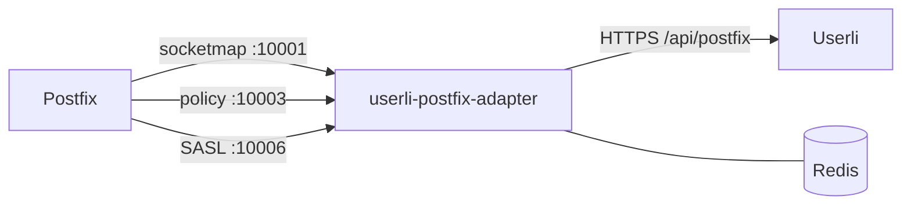

# Postfix

Postfix uses Userli to decide

* which **domains** and **mailboxes** exist,
* where **aliases** go (including `postmaster@` and `abuse@`),
* which **sender addresses** a user may use,
* how many emails a user may **send** (SMTP quota),
* whether an SMTP client may **authenticate** (SASL).

The connection is made by the
[userli-postfix-adapter](https://github.com/systemli/userli-postfix-adapter),
a small Go service running next to Postfix. It implements the Postfix
[socketmap](https://www.postfix.org/socketmap_table.5.html) protocol, a
[policy server](https://www.postfix.org/SMTPD_POLICY_README.html) for rate
limiting and a Dovecot-compatible SASL server.



## On the Userli host

Create an API token with the scope `postfix`:

```shell
bin/console app:api-token:create --name "Postfix" --scopes postfix
```

## On the Postfix host

### Run the adapter

Install the adapter from its
[releases](https://github.com/systemli/userli-postfix-adapter/releases) or run
its container image. It needs Redis for caching and rate limiting. Main
settings:

| Variable              | Description |
|-----------------------|-------------|
| `USERLI_BASE_URL`     | URL of Userli, e.g. `https://users.example.org` |
| `USERLI_TOKEN`        | API token with the `postfix` scope |
| `REDIS_URL`           | Redis connection, e.g. `redis://localhost:6379/0` |
| `SASL_LISTEN_ADDR`    | Enables SMTP authentication, e.g. `:10006` or `/var/spool/postfix/private/auth` |
| `POSTFIX_RECIPIENT_DELIMITER` | Your `recipient_delimiter`, e.g. `+` |

See the [adapter README](https://github.com/systemli/userli-postfix-adapter#configuration)
for all options and its metrics.

### Lookups

```text title="/etc/postfix/main.cf"
virtual_mailbox_domains = socketmap:inet:localhost:10001:domain
virtual_mailbox_maps    = socketmap:inet:localhost:10001:mailbox
virtual_alias_maps      = socketmap:inet:localhost:10001:alias
smtpd_sender_login_maps = socketmap:inet:localhost:10001:senders
```

Deliver mail to Dovecot via LMTP, for example
`virtual_transport = lmtp:unix:private/dovecot-lmtp`.

To stop users from sending with addresses that don't belong to them, add
`reject_sender_login_mismatch` to `smtpd_sender_restrictions` on the
submission port.

### SMTP authentication

```text title="/etc/postfix/main.cf"
smtpd_sasl_type = dovecot
smtpd_sasl_path = inet:localhost:10006
smtpd_sasl_auth_enable = yes
```

Authentication fails for deleted accounts and accounts that have to change
their password. Accounts with the role [*Spam*](../../admin/roles.md#spam) can
authenticate, but the [policy server](#sending-restrictions) limits what they
can send. You can also use Dovecot's SASL server instead.

### Rate limiting

```text title="/etc/postfix/main.cf"
smtpd_end_of_data_restrictions = check_policy_service inet:localhost:10003
```

The limits come from Userli: per user or alias, or the global default (see
[Admin Guide → Settings](../../admin/settings.md#smtp-quota-limits)).

### Sending restrictions

```text title="/etc/postfix/main.cf"
smtpd_recipient_restrictions =
    check_policy_service inet:localhost:10003,
    permit_sasl_authenticated,
    reject_unauth_destination
```

For authenticated senders the adapter reads `sending_allowed` and
`allowed_recipients` from the SMTP quota response. If sending is not allowed,
the adapter rejects every recipient except the allowed ones. This is how
accounts with the role *Spam* can only write to the
[support address](../../admin/settings.md#email-configuration). If Userli is
unreachable, the adapter defers the mail (`450`) instead of letting it pass.

!!! warning

    Place the policy service **before** `permit_sasl_authenticated`. Without it,
    accounts with the role *Spam* can send to anyone. Update the adapter and
    Postfix before you upgrade Userli, because older adapters ignore these
    fields.

## Test

```shell
postmap -q "example.org" socketmap:inet:localhost:10001:domain
postmap -q "user@example.org" socketmap:inet:localhost:10001:mailbox
postmap -q "alias@example.org" socketmap:inet:localhost:10001:alias
postmap -q "user@example.org" socketmap:inet:localhost:10001:senders
```

Lookups are cached in Userli and in the adapter for a few minutes. Changes may
take a short time to reach Postfix.
