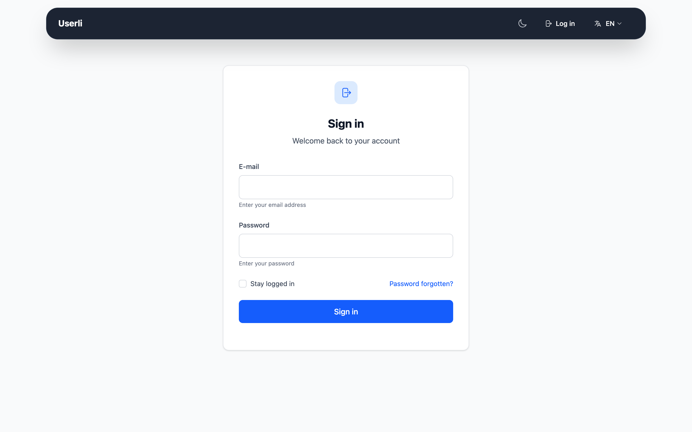
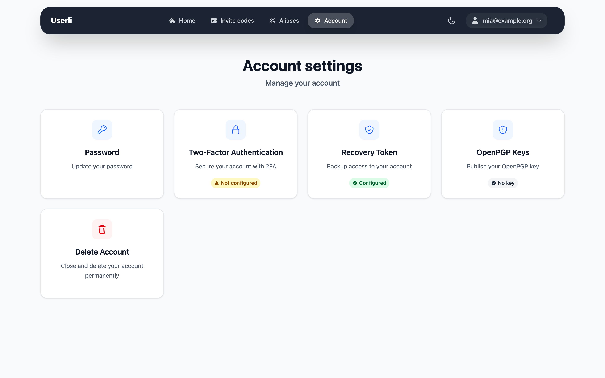
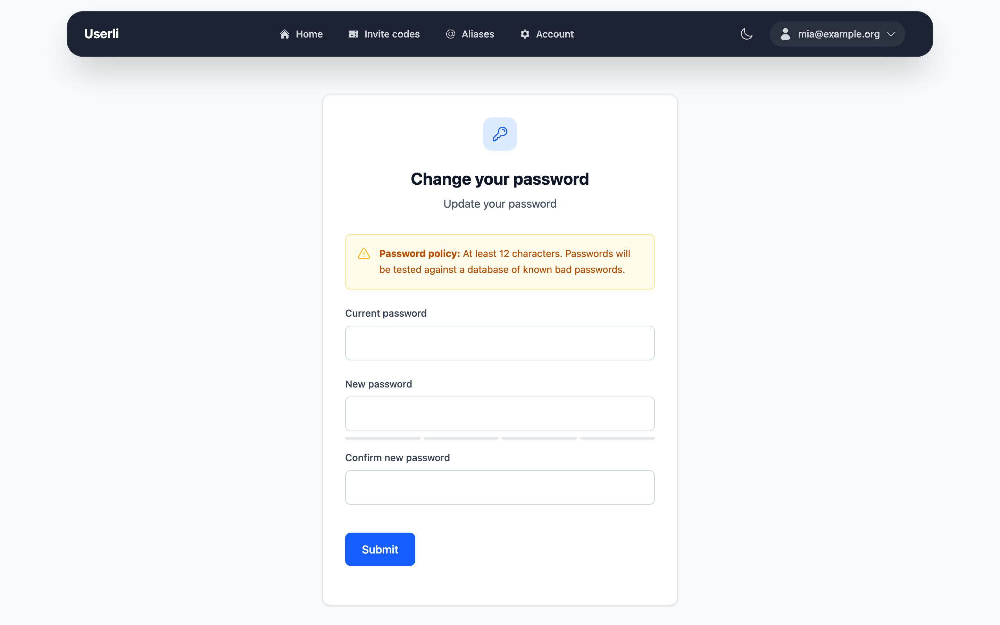

# Sign in and your account

## Sign in

{class="screenshot"}

Open the web address of your provider and click **Sign in** (or use the form on
the start page). Enter

* **E-mail:** your full email address. On most services, the part before the
  `@` is enough for addresses on the main domain.
* **Password:** your password.

If you have turned on [two-factor authentication](security.md#two-factor-authentication),
you are asked for a 6-digit code afterwards.

If the sign-in fails, check your address and password. Forgot your password?
Click **Password forgotten?** and follow [Forgot your password](recovery.md).

To sign out, open the user menu at the top right and click **Log out**.

## Your account overview

After signing in you see the overview of your account:

{class="screenshot"}

| Card                 | What it does                                                                                         |
|----------------------|------------------------------------------------------------------------------------------------------|
| **Webmail**          | Opens the webmail of your provider (only shown if available).                                        |
| **Invite codes**     | Shows your [invite codes](invite-codes.md) (only shown if invitations are enabled).                  |
| **Alias addresses**  | Manage your [aliases](aliases.md).                                                                   |
| **Account settings** | Password, two-factor authentication, recovery token, [app passwords](app-passwords.md), OpenPGP keys and [account deletion](delete.md). |

### Security alert

If your password was found in a database of known data breaches, a red
**Security Alert** banner appears on every page. Your password is checked
automatically when you sign in. Change your password as soon as possible – the
banner disappears afterwards.

### Account restricted

If you see the page *"Account restricted"*, your provider has flagged your
account as a spammer or as compromised. You can still sign in and read your
emails, but you can only send emails to the support of your provider. Contact
the support to unlock your account.

## Account settings

**Account → Account settings** shows the status of your security features at a
glance.

### Change your password

{class="screenshot"}

Go to **Account settings → Password**. Enter your current password and your new
password twice, then click **Submit**.

The new password must have at least 12 characters, must not appear in known
data breaches and must differ from the old one.

!!! tip

    Changing your password does **not** change your recovery token. Your
    existing token stays valid.

!!! info "Password change required"

    If your admin requires a password change (for example, after setting an
    initial password for you), every page redirects to the password form until
    you have chosen a new password. Your email program cannot sign in until
    then, either.

### Change the language

Open the user menu at the top right and choose a **Language**. Userli also
uses the language of your web browser automatically. Emails from Userli are
sent in the language you are using.

You can switch between light and dark mode with the toggle in the navigation
bar.
