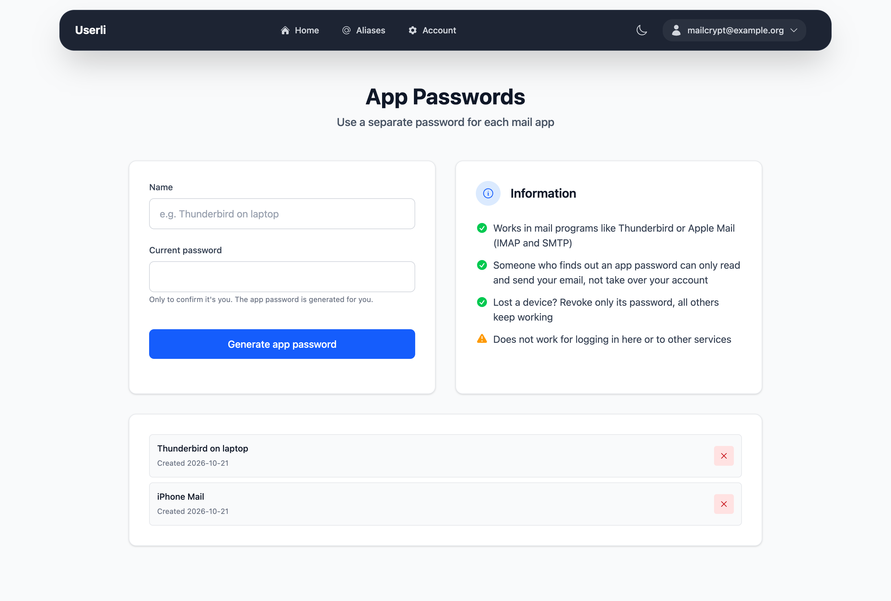
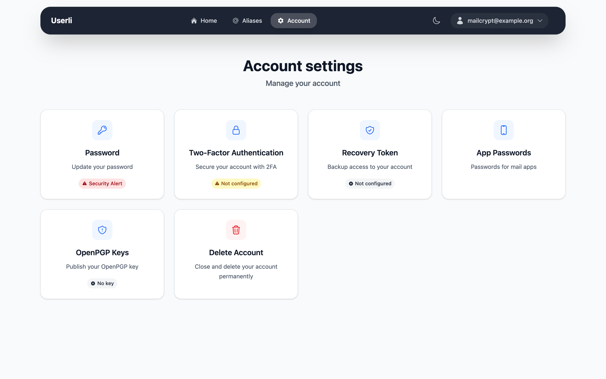
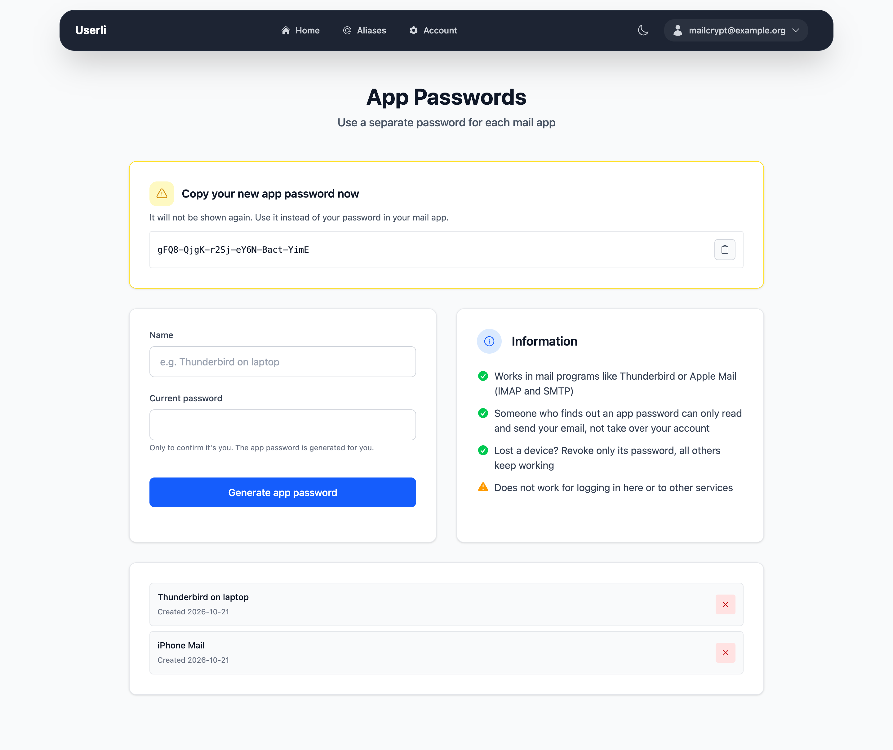

# App passwords

{class="screenshot"}

An app password is a separate password for one email program, for example
Thunderbird on your laptop or the mail app on your phone. Use it instead of
your password when you set up the app.

App passwords work for reading and sending email (IMAP, SMTP) in mail
programs like Thunderbird or Apple Mail. They do **not** work for signing in to
this web interface or to other services.

This makes them safer than using your password everywhere:

* Someone who finds out an app password can only read and send your email. They
  can't sign in here, so they can't change your password or take over your
  account.
* If a device gets lost, delete its app password. Your password and your other
  devices keep working.

## Generate an app password

{class="screenshot"}

1. Go to **Account settings → App Passwords**.
2. Enter a **Name** that tells you where you use it, for example
   *Thunderbird on laptop*. Each name can be used only once.
3. Enter your current password to confirm it's you and click **Generate app
   password**.
4. Copy the new app password and enter it in your email program instead of
   your password.

{class="screenshot"}

!!! warning

    The app password is shown only once. If you lose it, delete it and create
    a new one.

## Delete an app password

Go to **Account settings → App Passwords**, click the delete button (×) next to
the app password and confirm. The app using it can't sign in anymore.

Changing your password does not delete your app passwords. If you reset
your password with your recovery token, your provider resets your account or you
delete your account, all app passwords are deleted.
