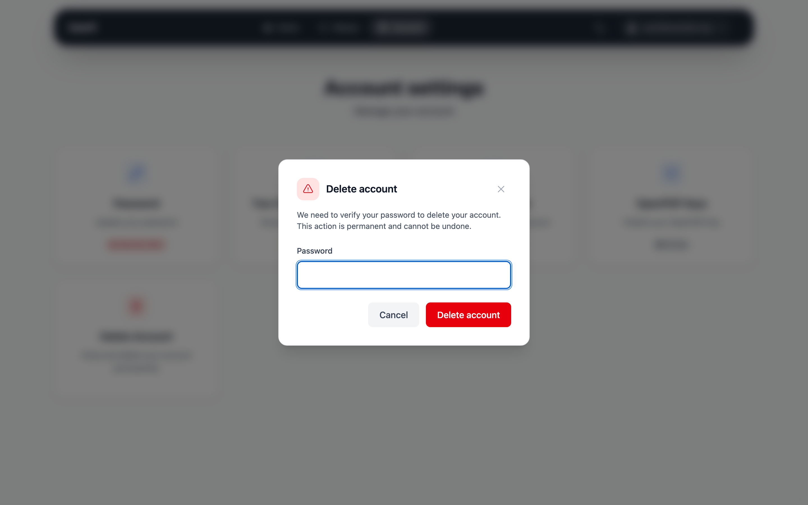

# Delete your account

!!! tip "Before you delete"

    Save the emails you want to keep, for example by copying them to a local
    folder in your email program. After deletion you can't sign in anymore.

Go to **Account settings** and click **Delete Account**. In the dialog, enter
your password and click **Delete account**. You are signed out immediately and
can't sign in to the web interface or your email program anymore. Your
provider usually removes the mailbox with your emails from the mail server
after a while.

{class="screenshot"}

!!! danger "Deletion cannot be undone"

    * Your password, recovery token and mailbox encryption keys are deleted.
      Your encrypted emails can't be decrypted anymore.
    * All your aliases are deleted.
    * Unused invite codes are deleted.
    * Your address can **never** be registered again – not by you, not by
      anybody else.

## Inactive accounts

Your provider may delete accounts that were not used for about two years.
Signing in to the web interface or your email program counts as use.
