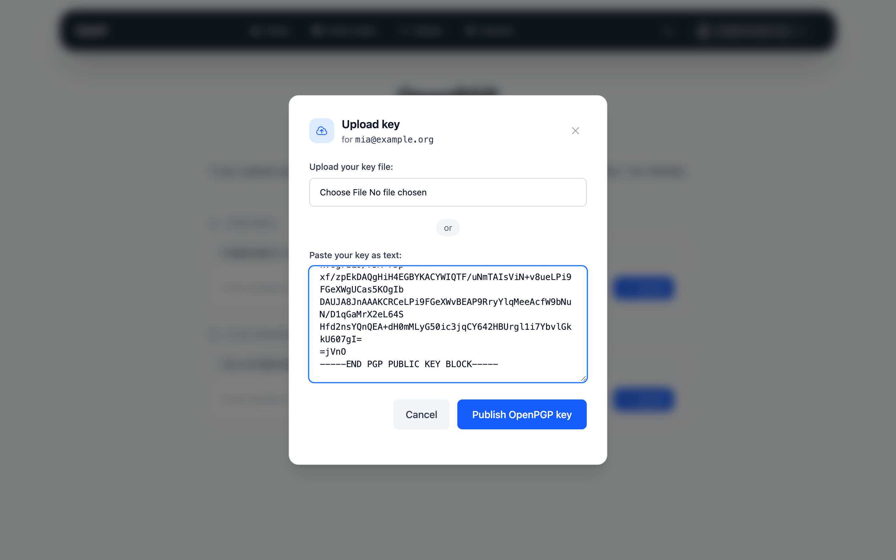
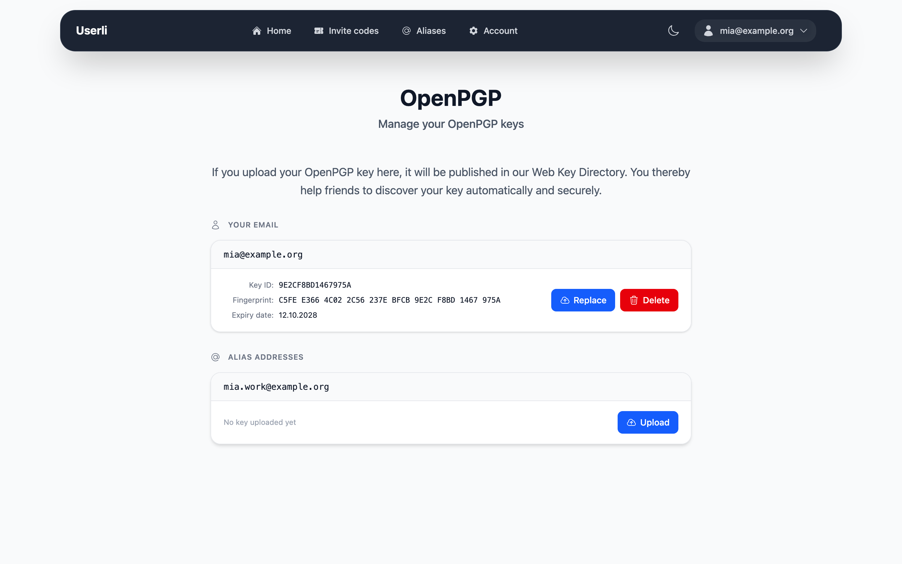

# OpenPGP keys

[OpenPGP](https://www.openpgp.org/) lets people encrypt emails so that only the
recipient can read them. To send you an encrypted email, others need your
**public key**.

If you upload your public key to Userli, it is published in the
**Web Key Directory (WKD)** of your provider. Email programs such as
Thunderbird, GnuPG or K-9 Mail with OpenKeychain then find your key
automatically when someone writes to you.

{class="screenshot"}

!!! note

    Only upload your **public** key. Never share your private key.

## Publish a key

1. Go to **Account settings → OpenPGP Keys**.
2. Find the address – your own address or one of your custom aliases – and
   click **Upload**.
3. Either choose your key file (up to 4 MB) or paste the key as text (it starts
   with `-----BEGIN PGP PUBLIC KEY BLOCK-----`).
4. Click **Publish OpenPGP key**.

{class="screenshot"}

The uploaded data must contain exactly one key for that address. Afterwards the
card shows the key ID, the fingerprint and the expiry date.

{class="screenshot"}

To export your public key with GnuPG:

```shell
gpg --export --armor you@example.org > publickey.asc
```

## Replace or delete a key

* **Replace:** click **Replace** and upload the new key, for example after
  extending its expiry date.
* **Delete:** click **Delete**, enter your password and confirm. The key is
  removed from the Web Key Directory.

Keys can be published for your own address and for custom aliases, not for
random aliases.
