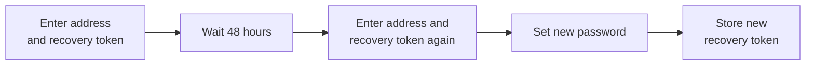
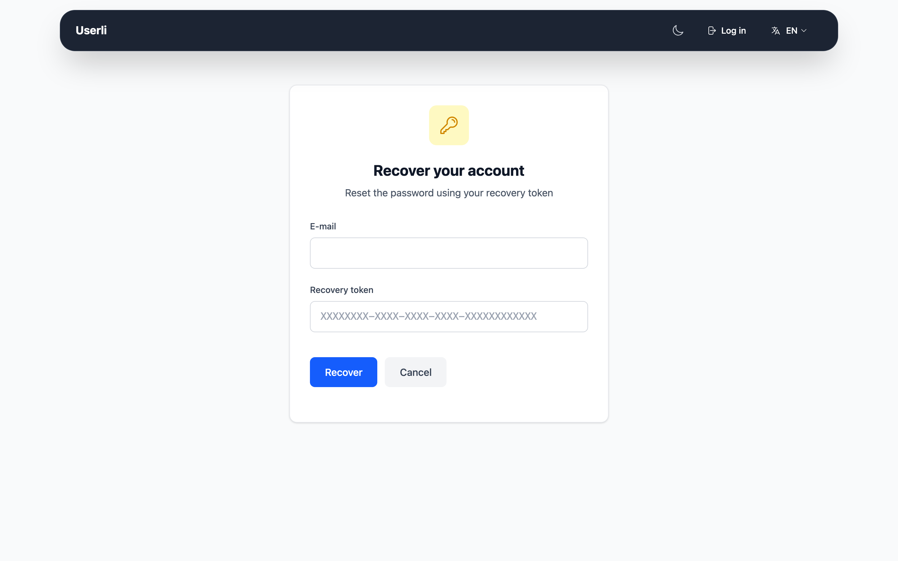

# Forgot your password

If you forgot your password, you can set a new one with your
**recovery token**. Your emails stay readable.

!!! warning "Without a recovery token"

    If you have lost both your password and your recovery token, only your
    provider can help. An admin can set a new password, but your existing
    encrypted emails will be lost.

## How it works

For your security, password recovery takes two steps with a waiting period of
**48 hours** in between. During this time, you receive an email and can stop
the recovery in case someone else started it.

## Step 1: Start the recovery

{class="screenshot"}

1. Click **Password forgotten?** on the sign-in page.
2. Enter your **E-mail** address and your **Recovery token** and click
   **Recover**.
3. The page shows the date and time when you can continue. Keep your recovery
   token until then.

You receive an email that your password will be reset. The waiting period can't
be shortened.

!!! danger "You didn't start this?"

    If you receive this email but did not start the recovery, someone else knows
    your recovery token. Sign in and
    [create a new recovery token](security.md#create-a-new-recovery-token)
    immediately. This stops the recovery.

## Step 2: Set a new password

After 48 hours, open **Password forgotten?** again and enter the same address
and recovery token. Now you can choose a new password (at least 12 characters,
not found in known data breaches).

You have 30 days to finish this step. After that, you have to start again.

## Step 3: Store your new recovery token

Your old recovery token has been used up. Userli shows you a **new recovery
token**. Store it safely, confirm and click **Continue**. Then sign in with your
new password.

!!! note "Two-factor authentication and mail app passwords are reset"

    The recovery turns off two-factor authentication, because you may have lost
    your phone as well. [Turn it on again](security.md#turn-on-2fa) after
    signing in.

    It also deletes all [mail app passwords](mail-app-passwords.md), in case
    someone else created one. Create new ones for your mail apps.
