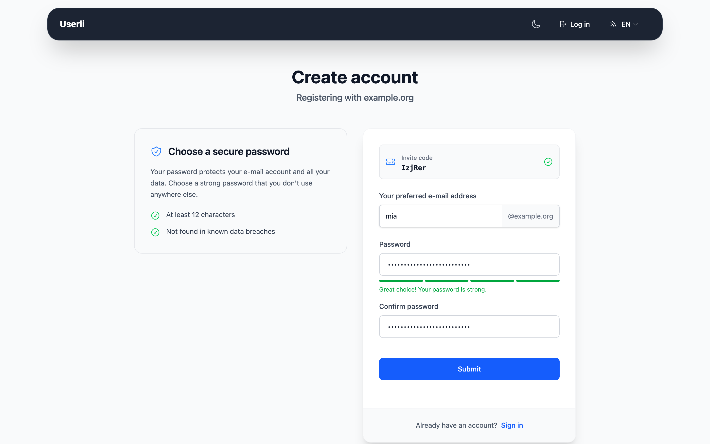
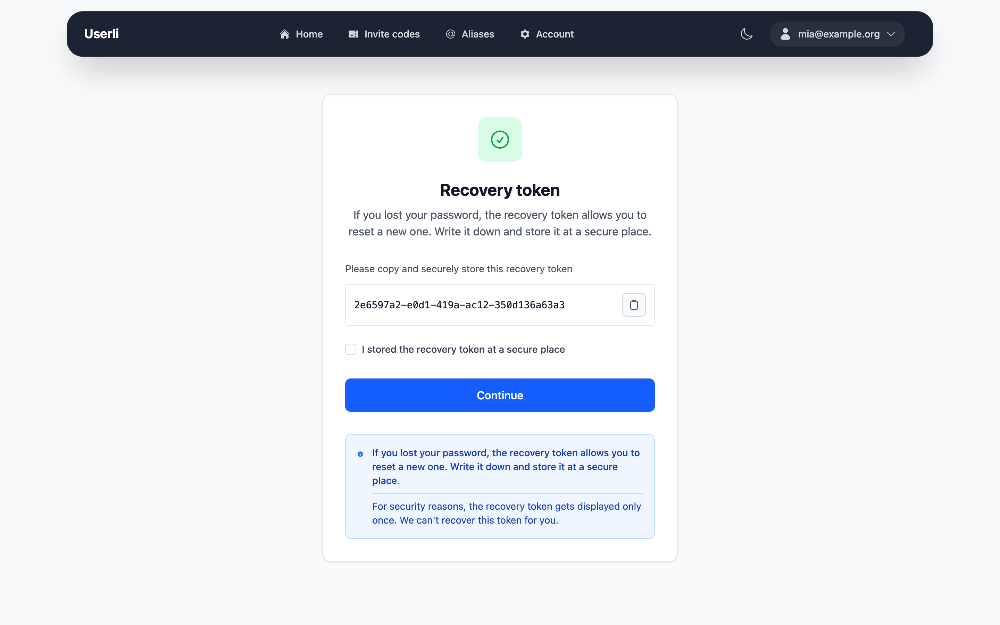
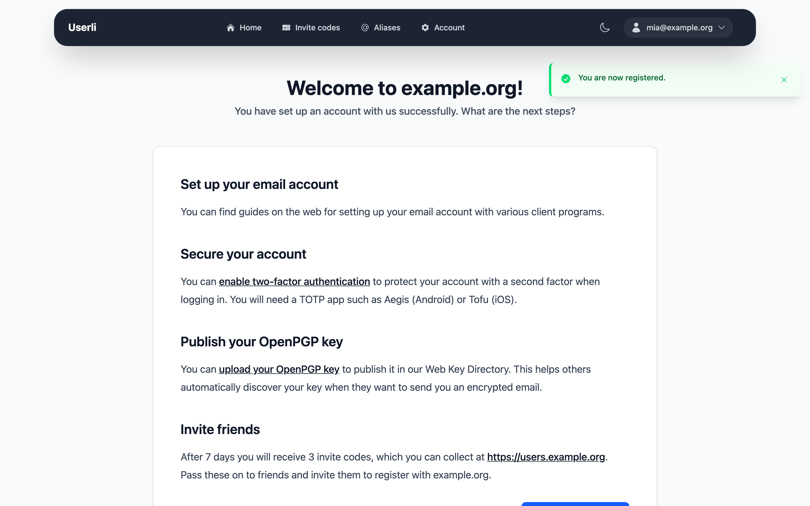

# Create an account

New accounts can only be created with an **invite code**. An invite code is a
code of six letters and digits, for example `aB3xY9`. You get one from someone
who already has an account – every user can receive invite codes to invite
friends (see [Invite codes](invite-codes.md)).

!!! note "Why invite codes?"

    Invite codes protect the service from mass registrations by spammers. If you
    don't know anybody with an account, ask your provider whether they give out
    invite codes.

## Step 1: Enter the invite code

You can start in two ways:

* **You got a link** like `https://users.example.org/register/aB3xY9`: open it,
  and you skip directly to step 2.
* **You got only the code:** open the start page of your provider, enter it in
  the *Registration* box under *Invite code* and click **Create account**.

If the code is wrong or was already used, you see *"The invite code is
invalid."* or *"The invite code has already been used."* If you see the page
*"Registration closed"*, your provider has stopped registrations for now.

## Step 2: Choose your address and password

{class="screenshot"}

**Your preferred e-mail address**
: Enter only the part before the `@`. The domain is fixed by the invite code.

    * Use 3 to 32 characters.
    * Allowed are lowercase letters, digits and `-`, `_` and `.`.
    * Some names such as `admin`, `abuse` or `postmaster` are reserved.
    * An address that was used before – even by a deleted account – can never
      be registered again.

**Password** and **Confirm password**
: Your password must

    * have at least 12 characters, and
    * not appear in a database of known data breaches
      ([Have I Been Pwned](https://haveibeenpwned.com/Passwords)).

    The meter below the field shows whether your password is strong enough.
    Use a password that you don't use anywhere else. A password manager helps.

Click **Submit**.

## Step 3: Store your recovery token

{class="screenshot"}

Right after registration you see your **recovery token** – a long code like
`1a2b3c4d-....`. If you forget your password, this token is the only way to
get back into your account and keep your emails readable.

* Copy it with **Copy to clipboard** and store it somewhere safe, for example
  in a password manager or printed on paper.
* The token is shown **only once**. Nobody, including your provider, can show
  it to you again.

Check *I stored the recovery token at a secure place* and click **Continue**.

## Step 4: Welcome

{class="screenshot"}

Your account is ready and you are signed in. The welcome page suggests the next
steps:

* Set up your email program or open the webmail.
* [Turn on two-factor authentication](security.md#two-factor-authentication).
* [Publish your OpenPGP key](openpgp.md), if you use one.
* [Invite friends](invite-codes.md) – after a waiting period you get invite
  codes, too.

You also receive a welcome email in your new inbox.
