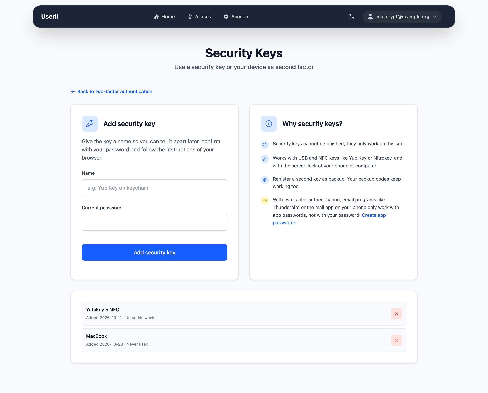

# Secure your account

Two features protect your account: **two-factor authentication** keeps others
out even if they know your password, and the **recovery token** lets you back
in if you forget your password.

## Two-factor authentication

{class="screenshot"}

With two-factor authentication (2FA) you confirm every sign-in to the web
interface with a second factor, in addition to your password. Go to
**Account settings → Two-Factor Authentication** to see which factors are set
up. You can use one or several of them:

- **Authenticator app**: a 6-digit code that changes every 30 seconds, from an
  app like [Aegis](https://getaegis.app/) (Android), Tofu (iOS) or your
  password manager.
- **Security keys**: a USB or NFC key like a YubiKey or Nitrokey, or the screen
  lock of your phone or computer. Security keys can't be phished: they only
  work on the website they were added on.
- **Backup codes**: one-time codes for when you lose your phone or key. They
  are created when you set up your first factor.

!!! note

    2FA protects the sign-in to the web interface and, if your provider
    uses Roundcube, to webmail. Depending on your provider, email programs
    then need an [app password](app-passwords.md) instead of your password.

### Set up an authenticator app

1. Go to **Account settings → Two-Factor Authentication** and click **Set up**
   under *Authenticator App*.
2. Enter your password and click **Set up**.
3. Scan the **QR code** with your authenticator app. If you can't scan it,
   copy the **Setup Key** and enter it manually in the app.
4. Enter the 6-digit code shown in the app under **Authentication code** and
   click **Verify**.
5. If this is your first factor, you now see your six **backup codes**. Copy
   them and store them safely, check *Backup codes stored securely* and click
   **Verify**.

### Add a security key

{class="screenshot"}

1. Go to **Account settings → Two-Factor Authentication** and click **Add**
   under *Security Keys*.
2. Enter a **Name** that helps you recognize the key later, for example
   *YubiKey on keychain*, and your password.
3. Click **Add security key** and follow the instructions of your browser:
   insert and touch the key, or confirm with your device or password manager.
4. If this is your first factor, you now see your six **backup codes**. Store
   them safely, check *Backup codes stored securely* and click **Verify**.

Add a second key as a spare, so you can still sign in if you lose one. To
remove a key, click the **×** next to it and confirm with your password.

### Backup codes

Each backup code works **once**. The overview shows how many codes are left
and warns when only a few remain.

To get new codes, click **Regenerate** under *Backup Codes* and confirm with
your password. Your old codes stop working.

### Sign in with 2FA

After entering your email address and password, you confirm the sign-in with
one of your factors:

- With security keys, click **Use security key** and follow the instructions
  of your browser.
- With an authenticator app, enter the current code under
  **Authentication code**.

The page offers to switch to your other factors. To use a backup code, click
**Use a backup code** – or enter it instead of the code from the app.

### Turn off 2FA

Remove all security keys and turn off the authenticator app (**Manage → Disable**
under *Authenticator App*). When the last factor is gone, 2FA is off and the
backup codes are deleted.

## Recovery token

{class="screenshot"}

The recovery token is a long code like
`1a2b3c4d-5e6f-7a8b-9c0d-1e2f3a4b5c6d`. You received it when you created your
account. With it you can [set a new password](recovery.md) if you forget yours.

Your emails are stored encrypted. Only your password – or your recovery
token – can unlock them. That is why your provider can't simply reset your
password without making your old emails unreadable.

### Create a new recovery token

Create a new token if you lost the old one, if somebody else might know it, or
if your account doesn't have one yet (the card shows *Not configured*).

1. Go to **Account settings → Recovery Token**.
2. Enter your password and click **Create new recovery token**.
3. Copy the new token and store it safely. Check *I stored the recovery token
   at a secure place* and click **Continue**.

The old token stops working immediately. A password recovery that somebody
started with the old token is cancelled.
