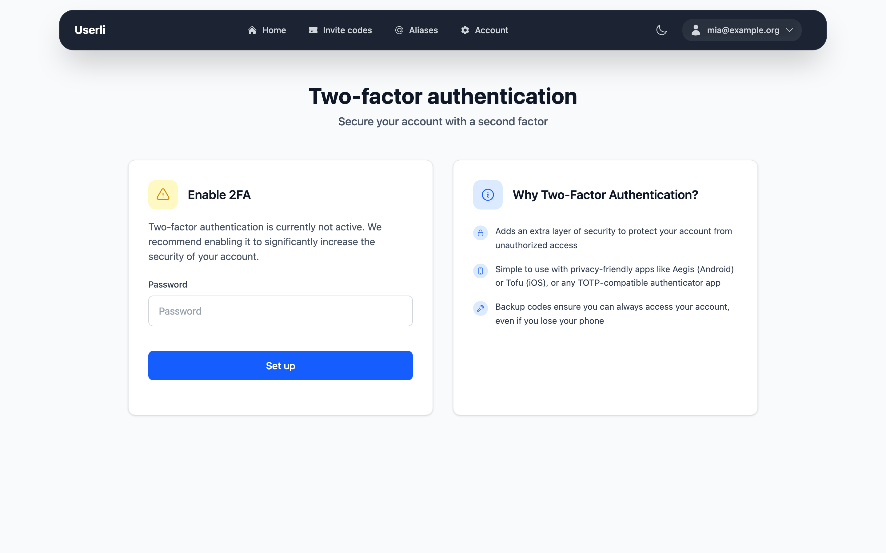
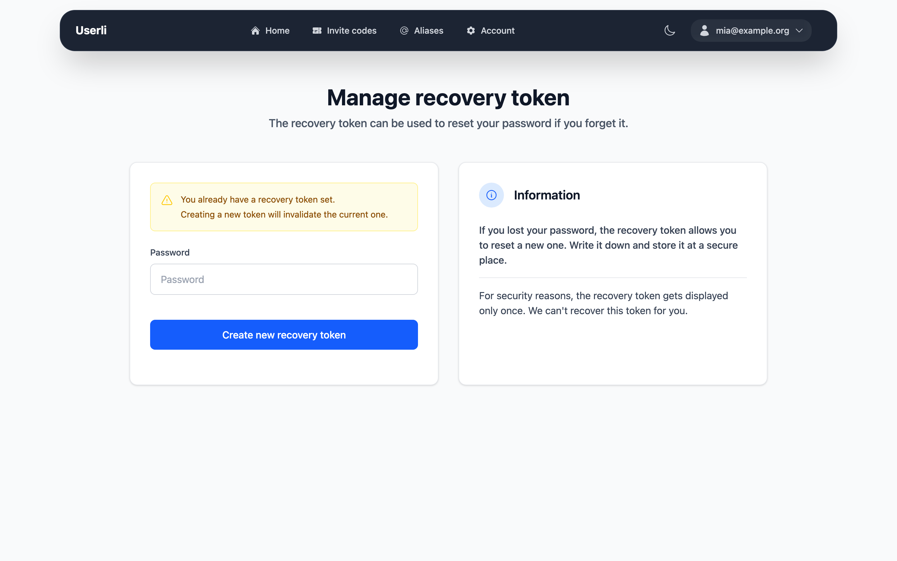

# Secure your account

Two features protect your account: **two-factor authentication** keeps others
out even if they know your password, and the **recovery token** lets you back
in if you forget your password.

## Two-factor authentication

{class="screenshot"}

With two-factor authentication (2FA) you need a 6-digit code from an
authenticator app on your phone, in addition to your password, to sign in to
the web interface. The code changes every 30 seconds.

You need an authenticator app (TOTP), for example
[Aegis](https://getaegis.app/) (Android), Tofu (iOS) or the app of your
password manager.

!!! note

    2FA protects the sign-in to the web interface. Your email program keeps
    using only your password, or a [mail app password](mail-app-passwords.md).

### Turn on 2FA

1. Go to **Account settings → Two-Factor Authentication**.
2. Enter your password and click **Set up**.
3. Scan the **QR code** with your authenticator app. If you can't scan it,
   copy the **Setup Key** and enter it manually in the app.
4. Enter the 6-digit code shown in the app under **Authentication code** and
   click **Verify**.
5. You now see six **backup codes**. Each backup code can be used **once**
   instead of a code from the app – for example, if you lose your phone. Copy
   them and store them safely, check *Backup codes stored securely* and click
   **Verify**.

2FA is now active.

!!! warning

    The backup codes are shown only once. To get new ones, turn 2FA off and on
    again.

### Sign in with 2FA

After entering your email address and password, open your authenticator app
and enter the current code under **Authentication code**. Instead of the code
you can also enter one of your unused backup codes.

### Turn off 2FA

Go to **Account settings → Two-Factor Authentication**, enter your password and
click **Disable**.

## Recovery token

{class="screenshot"}

The recovery token is a long code like
`1a2b3c4d-5e6f-7a8b-9c0d-1e2f3a4b5c6d`. You received it when you created your
account. With it you can [set a new password](recovery.md) if you forget yours.

Your emails are stored encrypted. Only your password – or your recovery
token – can unlock them. That is why your provider can't simply reset your
password without making your old emails unreadable.

### Create a new recovery token

Create a new token if you lost the old one, if somebody else might know it, or
if your account doesn't have one yet (the card shows *Not configured*).

1. Go to **Account settings → Recovery Token**.
2. Enter your password and click **Create new recovery token**.
3. Copy the new token and store it safely. Check *I stored the recovery token
   at a secure place* and click **Continue**.

The old token stops working immediately. A password recovery that somebody
started with the old token is cancelled.
